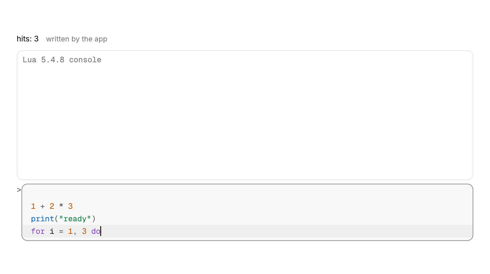
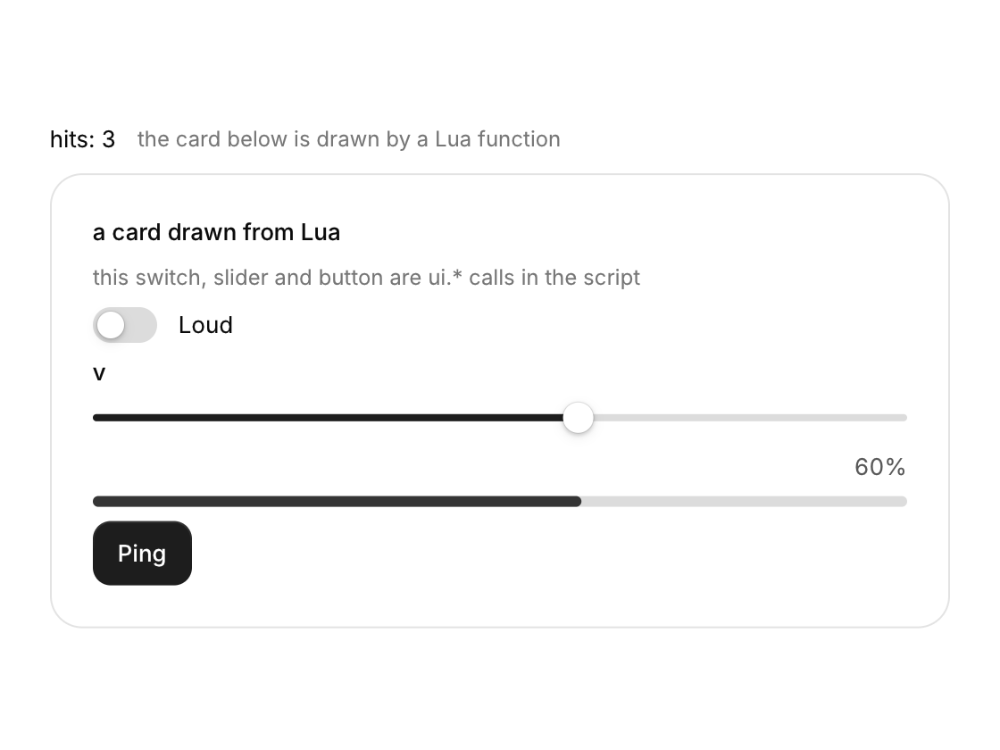

# More components

The second half of the library: richer actions and inputs, pickers, disclosure, data views, more charts, motion, AI interface pieces and developer tools. Everything follows the same rules as the [core components](components.md): named options, keyboard support, light and dark, reduced motion. Each family has a page in the gallery (`./build/examples/gallery`, section *Extended*).

## Actions

### Split button

A main action with a menu of related actions behind a chevron.

<picture><source media="(prefers-color-scheme: dark)" srcset="images/components/split-button-dark.png"></picture>

```c
static const char *more[] = { "Save as draft", "Save and publish", "Schedule..." };
switch (cui_split_button(ui, "Save", more, 3, .icon = CUI_ICON_SAVE)) {
case 0: save(); break;              /* the main part */
case 1: save_draft(); break;        /* menu item 0 */
case 2: publish(); break;
case 3: schedule(); break;
}
```

Returns 0 for the main action, 1 + i for menu item i, -1 otherwise. Options: `variant` (primary by default), `size`, `icon`, `item_icons`, `disabled`. Down arrow on the chevron opens the menu.

The result comes on the frame of the click or the choice; on every other frame the call returns -1. `items` is your array of `count` labels and is only read. `item_icons`, when you set it, needs an icon or `NULL` for each item. The menu opens under the button, lined up with its trailing edge, and closes when an item is chosen. `disabled` turns off both parts. The button keeps its state by its label, so two split buttons with the same label in one scope need different keys: `"Save##draft"` still shows "Save".

Keyboard: Tab stops on the main part and on the chevron, and Enter or Space presses the focused one. In the open menu, Up and Down move the highlight, Enter chooses and Esc closes the menu.

### Toggle group

A row of joined toggle buttons, each on or off, or exactly one on at a time.

<picture><source media="(prefers-color-scheme: dark)" srcset="images/components/toggle-group-dark.png"></picture>

```c
static bool format[4];          /* bold, italic, underline, code */
const char *labels[] = { "Bold", "Italic", "Underline", "Code" };
const char *icons[] = { CUI_ICON_BOLD, CUI_ICON_ITALIC, CUI_ICON_UNDERLINE, CUI_ICON_CODE };
cui_toggle_group(ui, "format", labels, 4, format, .icons = icons, .icon_only = true);
```

Each item flips its own `bool`. With `.exclusive = true` exactly one stays on, like a radio group. With `icon_only` the labels become tooltips. Arrow keys move between items.

Returns true on the frame an item is clicked. `format` is your array with one `bool` for each item: the group reads it every frame and writes the item that was clicked, or all of them when `exclusive` is set. Exclusive mode acts on clicks only, so start with one value already true; a click on the item that is on leaves it on. At most 32 items are shown. `icon_only` hides a label only where that item has an icon. For a choice held in one `int`, use the segmented control.

Keyboard: Tab, or Left and Right, move between the toggles, and Enter or Space flips the focused one.

### Confirm button

A button for destructive actions that asks for a second click before it fires.

```c
if (cui_confirm_button(ui, "Delete project", .icon = CUI_ICON_TRASH_2)) delete_project();
```

The first click morphs the button into a red "Click to confirm" with a countdown line; the second click fires. It disarms after `timeout` seconds (3), on Esc, or when you click elsewhere. Options: `confirm_label`, `icon`, `variant`, `size`, `timeout`.

Returns true once, on the frame of the second click. You keep no state: the armed state is stored under the button's label, so two confirm buttons with the same label in one scope need different keys (`"Remove##member"` shows "Remove"). `variant` sets the look at rest, secondary by default; the armed look is always the danger color with a warning icon. `timeout` is in seconds, and 0 means 3. When the question needs a sentence use the confirm popover, and for an action that should take effort use the hold button.

Keyboard: Tab focuses the button, and Enter or Space presses it, so two presses confirm. Esc disarms it while it has the focus.

### Status button

A button that shows the progress of the work it started: a spinner while busy, then a check or an error.

<picture><source media="(prefers-color-scheme: dark)" srcset="images/components/morph-buttons-dark.png"></picture>

```c
static cui_status status;
if (cui_status_button(ui, "Save changes", status, .success_label = "Saved")) { status = CUI_STATUS_BUSY; start_save(); }
/* later: status = CUI_STATUS_SUCCESS (or CUI_STATUS_ERROR), then back to CUI_STATUS_IDLE */
```

Shows the life of the work it started: idle, a spinner while busy, a check or an error. The width springs between states and the content cross-fades. Clicks only count while idle.

Returns true on the frame it is clicked while `status` is `CUI_STATUS_IDLE`. `status` is your variable, passed by value: the button never changes it. Set `CUI_STATUS_BUSY` when the work starts, `CUI_STATUS_SUCCESS` or `CUI_STATUS_ERROR` when it ends, and `CUI_STATUS_IDLE` again once the result has been seen. Without options the busy text is the label followed by an ellipsis, the success text is "Done" and the error text is "Failed"; `busy_label`, `success_label` and `error_label` replace them. `variant` is primary by default. A plain button with `.loading = true` shows only the spinner.

Keyboard: Tab focuses the button, and Enter or Space presses it.

### Reactions

Reaction buttons with a count each, as under a message or a post.

```c
static cui_reaction re[] = { { CUI_ICON_THUMBS_UP, 12, true }, { CUI_ICON_HEART, 4, false } };
int changed = cui_reactions(ui, "reactions", re, 2);   /* index that toggled, or -1 */
```

Clicking toggles `active` and adjusts `count`; the number rolls up or down and the icon pops.

Returns the index of the reaction that was clicked this frame, or -1. `re` is your array and the library writes to it: a click flips `active` and adds 1 to `count` or takes 1 away, and `count` never goes below 0. Send the change to your server when the call returns an index. A count you change yourself, such as one that arrives from the network, rolls to its new value in the same way. Each `cui_reaction` is an icon, a count and whether the current user has reacted. The `id` keeps the animation of each pill by its position in the array, so keep the array in a stable order.

Keyboard: Tab moves through the reactions, and Enter or Space toggles the focused one.

### Speed dial

A round floating button that fans out a few related actions.

```c
static const cui_speed_action acts[] = { { CUI_ICON_FILE_TEXT, "New note" }, { CUI_ICON_IMAGE, "Upload image" } };
int pick = cui_speed_dial(ui, "create", acts, 2, .tooltip = "Create");
```

Clicking fans the actions out with a stagger while the plus morphs into a close icon. Esc or a click elsewhere folds them. `placement` controls the direction (above and right aligned by default).

Returns the index of the action that was clicked, or -1, and choosing an action folds the dial. `acts` is your array of icon and label pairs; a `NULL` label leaves only the round icon, and at most 16 actions are shown. The button is 52 points across and sits in the layout where you call it: only the fanned actions float, so pin it to a corner with a container placed there. `CUI_PLACE_BOTTOM` and `CUI_PLACE_BOTTOM_END` open the actions downward; `CUI_PLACE_BOTTOM_START` is the zero value and counts as not set.

Keyboard: Tab focuses the button, and Enter or Space opens or folds it. While it is open, Tab moves through the actions, Enter or Space chooses the focused one, and Esc folds the dial.

### Theme switcher and toggle

Controls that switch the app between light, dark and the system theme.

```c
static int mode = -1;                       /* -1 picks up the current theme */
cui_theme_switcher(ui, &mode, true);        /* light, dark, system */
cui_theme_toggle(ui);                       /* one icon button with a sun or a moon */
```

Light and dark are applied for you. For "system" (mode 2), read the OS setting (for example with `cui_app_desc.follow_system_theme`) and call `cui_set_theme`.

`cui_theme_switcher` returns true on the frame the choice changes. `mode` is your `int`: 0 is light, 1 is dark and 2 is system. The switcher writes the new choice into it, and a value outside the range, such as the -1 above, is replaced by 0 or 1 to match the theme in use. Pass `false` as the last argument to leave the system choice out. `cui_theme_toggle` needs no variable: it reads the current theme, flips it on a click and returns true on that frame. Both use a fixed internal id, so a second switcher or toggle in the same id scope needs a `cui_id_scope` around it.

Keyboard: in the switcher, Tab, or Left and Right, move between the choices. The toggle takes Enter or Space.

### User menu

An avatar, a name and a detail line that open an account menu with a header.

<picture><source media="(prefers-color-scheme: dark)" srcset="images/components/user-menu-dark.png"></picture>

```c
cui_user_menu(ui, "Maya Okafor", .detail = "maya@fieldwork.studio", .status = "online") {
    cui_menu_item(ui, "Profile", .icon = CUI_ICON_USER);
    cui_menu_item(ui, "Log out", .icon = CUI_ICON_LOG_OUT);
}
```

Full width for sidebars; `.compact = true` shows just the avatar for headers. Options: `detail`, `status`, `avatar` (a texture), `compact`, `placement`, `width`.

The block runs only while the menu is on screen, and each `cui_menu_item` in it returns true on the frame it is chosen, which closes the menu. You keep no state. The menu starts with a header that repeats the avatar, the name and `detail`. The name is also the menu's identity and, without `avatar`, the source of the initials. `status` takes "online", "away" or "busy", and any other word gives a gray dot. The menu is 248 points wide unless `width` is set. It opens above the row, or below a compact avatar; `placement` overrides both, except that `CUI_PLACE_BOTTOM_START` is the zero value and counts as not set.

Keyboard: Enter or Space on the avatar opens the menu. Up and Down move through its items, Enter chooses one, and Esc closes it.

### Swipe actions

A row that slides sideways to reveal actions such as archive or delete.

```c
static const cui_swipe_action done[] = { { CUI_ICON_CHECK, "Done", CUI_TONE_SUCCESS } };
static const cui_swipe_action more[] = { { CUI_ICON_ARCHIVE, "Archive", CUI_TONE_INFO }, { CUI_ICON_TRASH_2, "Delete", CUI_TONE_DANGER } };
cui_swipe_item_begin(ui, "mail-42", done, 1, more, 2);
cui_text(ui, "Quarterly report", .width = CUI_FILL);
int action = cui_swipe_item_end(ui);   /* 0 = left action 0, 100 + i = right action i, -1 = none */
```

Drag a row sideways, or swipe with two fingers on a trackpad. Past half the reveal width it snaps open; past 60% of the row it fires the first action on that side. Click the row or anywhere else to close it.

`cui_swipe_item_end` returns the action on the frame it is chosen: `i` for item `i` of the `left` array, `100 + i` for item `i` of the `right` array, and -1 otherwise. The `left` actions wait behind the left edge and show when the row is dragged to the right. Pass `NULL` and 0 for a side with no actions. The open position is kept under `id`, so give every row its own, such as the id of its record.

Keyboard: none. Swiping is a pointer, touch and trackpad gesture, so give the same actions another route, such as a context menu or buttons.

## Inputs

### Inline edit

Text that turns into a field when clicked, for renaming things in place.

<picture><source media="(prefers-color-scheme: dark)" srcset="images/components/inline-edit-dark.png"></picture>

```c
static char title[128] = "Q3 roadmap";
if (cui_inline_edit(ui, "title", title, sizeof title, .font = CUI_FONT_DISPLAY, .size = 26) & CUI_CHANGED) rename(title);
```

Looks like text, with a pencil on hover. Click (or Enter when focused) to edit in the same type with the text selected. Enter or clicking away saves, Esc restores the old text. Options: `font`, `size`, `placeholder`, `width`.

Returns `CUI_CHANGED` once, on the frame an edit ends with text that differs from what it started with, and 0 otherwise, including while typing. `title` is your buffer. The field edits it in place as the user types, so save it only when the call returns `CUI_CHANGED`. A cancelled edit puts the old text back, of which the library keeps up to 511 bytes. An empty buffer shows `placeholder`, or "Untitled". Without `width` the text hugs its content and the field grows as you type.

Keyboard: Tab focuses the text, and Enter or Space starts the edit. Enter saves and Esc cancels.

### Scrub field

A number you change by dragging sideways on it, as in design and 3D tools.

<picture><source media="(prefers-color-scheme: dark)" srcset="images/components/scrub-dark.png"></picture>

```c
static float opacity = 80;
cui_scrub(ui, "Opacity", &opacity, 0, 100, .suffix = "%");
```

Drag sideways anywhere on the field to change the value; hold Shift for steps ten times finer. A click without dragging lets you type a number. Arrow keys step when focused. A hairline along the bottom shows where the value sits in its range. Options: `step` (range / 100), `format`, `suffix`, `icon` (instead of the label), `width`.

### Money field

A field for an amount of money, with a currency symbol and grouped digits.

```c
static double amount = 1249.5;
cui_money_input(ui, "amount", &amount, .label = "Amount", .code = "USD");                       /* $ 1,249.50  USD */
cui_money_input(ui, "salary", &salary, .symbol = "\xe2\x82\xac", .code = "EUR", .decimals = -1); /* whole euros */
```

Shows grouped digits at rest and plain digits while you type, keeps at most `decimals` places (2; -1 for none) and ignores anything that is not a number. Options: `label`, `symbol` ("$"), `code`, `decimals`, `width`, `hint`.

Returns true on a frame the value changes, which while typing is every keystroke that alters the number. `amount` is your `double` in whole units of the currency. The field reads it while not focused, so a value set from code shows at once, and on leaving the field it rounds the value to `decimals` places and writes it back. Typing takes digits and one decimal point, and a comma counts as the point; a minus sign cannot be typed.

Keyboard: it edits like a text field. Left, Right, Home and End move the caret, and Backspace and Delete remove digits.

### Prefix and suffix

Fixed text before or after a field's value, such as `https://` or a unit.

Every text field takes muted text before and after the value:

```c
static char site[128], weight[16];
cui_input(ui, "site", site, sizeof site, .prefix = "https://");
cui_input(ui, "weight", weight, sizeof weight, .suffix = "kg");
```

`prefix` and `suffix` are options of `cui_input`, `cui_search` and `cui_textarea`, drawn inside the field's border in the muted color. They are not part of the value: your buffer holds only what the user types, so add the prefix yourself when you use the text, for example to build the URL. The call returns the same flags as any text field. Both strings are read every frame, so they can change with the unit the user picked. A prefix comes before the field's `icon`. The typing area gets the room that is left, so keep both short. `cui_number` has its own `suffix`, and the money field uses the pair for its symbol and currency code.

Keyboard: the field edits like any text field, with Left, Right, Home and End moving the caret.

### Shortcut recorder

A field that records a key combination, for settings where people choose their own shortcuts.

<picture><source media="(prefers-color-scheme: dark)" srcset="images/components/shortcut-recorder-dark.png"></picture>

```c
static cui_key_combo palette_key = { CUI_MOD_PRIMARY, CUI_KEY_K };
if (cui_shortcut_recorder(ui, "palette-key", &palette_key)) save_keymap();
if (cui_shortcut(ui, palette_key.mods, palette_key.key)) open_palette();
```

Click and press a combination. While recording, the field shows the modifiers you hold with a pulsing dot, and app shortcuts stay quiet. Backspace clears, Esc or Tab cancels. `cui_shortcut_label(ui, combo)` gives the text ("Ctrl Shift K"), `cui_key_name(key)` one key.

`cui_shortcut_recorder` returns true on the frame the combination changes: a new one was recorded, or it was cleared. `palette_key` is your `cui_key_combo`, a `mods` mask of `CUI_MOD_*` bits and a `key`, and the recorder writes both. A `key` of `CUI_KEY_NONE` means no shortcut, and the field then shows `placeholder` ("Click to record"). `cui_shortcut` returns true on the frame the key goes down with exactly those modifiers. `cui_shortcut_label` returns text that lives for the current frame only, so copy it to keep it.

Keyboard: Tab focuses the field, and Enter or Space starts recording. While recording, Backspace or Delete clears the shortcut, and Esc or Tab cancels.

## Pickers

### Multi-select

Picks several items from a list and shows them as chips in the field.

<picture><source media="(prefers-color-scheme: dark)" srcset="images/components/multi-select-dark.png"></picture>

```c
static bool chosen[6];
const char *langs[] = { "C", "C++", "Rust", "Zig", "Go", "Swift" };
cui_multi_select(ui, "langs", langs, 6, chosen, .label = "Languages", .searchable = true);
```

The field shows chips (with remove buttons) for up to `max_chips` items and "+N" for the rest. The list keeps itself open while you tick items and has a select all / clear action. Up, Down and Space or Enter work in the list.

Returns true on a frame the selection changes, whether from the list, a chip's remove button or the select all action. `chosen` is your array with one `bool` for each item; the picker reads and writes it and keeps only the search text. The search keeps the items that contain the typed text, ignoring the case of ASCII letters. The field is 300 points wide by default and shrinks in a narrower container.

Keyboard: Enter, Space or Down on the focused field opens the list. In the list, Up and Down move the highlight, Enter or Space ticks the highlighted item, and Esc closes the list.

### Date range picker

Picks a start and an end date, with presets such as the last 7 days.

<picture><source media="(prefers-color-scheme: dark)" srcset="images/components/date-range-dark.png"></picture>

```c
static cui_date_range trip;
cui_date_range_picker(ui, "trip", &trip, .label = "Dates");
cui_range_calendar(ui, "inline", &trip, 2);   /* the calendar on its own, one or two months */
```

Click a start and an end (in either order); while you choose the end, the band follows the pointer. Presets (today, last 7 days, this month...) sit on the left unless `.no_presets = true`. `cui_date_to_days` and `cui_date_from_days` convert dates to day numbers for arithmetic.

Keyboard: Enter or Space on the field opens the two months and Esc closes them. Inside, Tab moves through the presets and the days, and Enter picks the focused day: first the start, then the end.

### Time picker

Picks a time of day from scrolling columns of hours and minutes.

<picture><source media="(prefers-color-scheme: dark)" srcset="images/components/time-picker-dark.png"></picture>

```c
static int hour = 9, minute = 30;
cui_time_picker(ui, "start", &hour, &minute);
cui_time_picker(ui, "end", &hour2, &minute2, .twelve_hour = true, .minute_step = 15);
```

Hour and minute columns (and AM / PM) that open scrolled to the current value. `hour` is always 0 to 23.

Returns true on the frame a new hour, minute or half of the day is clicked. `hour` and `minute` are your two `int` variables: the picker reads them every frame and writes them while its list is open. `twelve_hour` changes only what is shown ("9:30 AM"), never what is stored. `minute_step` is the gap between the minutes offered and defaults to 5; a minute off the step still shows in the field, with no row marked. The list stays open after a click, so hour and minute can be set in one visit.

Keyboard: Enter or Space on the field opens the list of times and Esc closes it. The times themselves are picked with the pointer; they take no keyboard focus yet.

### Wheel picker and time dial

Touch-style pickers: drums of options you spin, and a clock face for setting a time.

<picture><source media="(prefers-color-scheme: dark)" srcset="images/components/wheels-dark.png"></picture>

```c
cui_wheel_picker(ui, "month", month_names, 12, &month, .width = CUI_PX(128), .loop = true);
cui_time_dial(ui, "alarm", &hour, &minute, 232);
```

Wheels are drums of options: drag with momentum, scroll or use the arrow keys, and they snap to an item. Set `loop` for values that wrap. Put several side by side with `join_left` / `join_right` to share one selection band, as in a date reel.

The time dial sets hours on two rings (1 to 12 outside, 13 to 00 inside), then switches to minutes when you let go. The hand springs the short way round. Click the hour or minute at the top to choose which one you set.

### Ruler and histogram sliders

Two sliders that show context: a ruler that slides under a fixed marker, and a range slider drawn over the distribution of the data.

<picture><source media="(prefers-color-scheme: dark)" srcset="images/components/ruler-histogram-dark.png"></picture>

```c
cui_ruler_slider(ui, "Height", &height, 120, 220, .unit = "cm");
cui_histogram_slider(ui, "Price", bins, 24, &lo, &hi, 0, 240, .format = "$%.0f");
```

The ruler is a tape that slides under a fixed marker; throw it and it glides, then snaps to `step`. Options: `step`, `major_every` (labelled ticks), `spacing` (points per step), `format`, `unit`, `width`. The histogram slider is a range slider with the distribution it filters drawn above it; bars inside the range light up.

Keyboard: the ruler takes Tab, and Left, Right, Up and Down move the value a step. The histogram slider's two handles are dragged with the pointer; they have no keys yet.

### Knob, fader and level meter

A rotary knob, a vertical fader and a level meter: the controls of audio, synth and mixer panels.

<picture><source media="(prefers-color-scheme: dark)" srcset="images/components/mixer-dark.png"></picture>

```c
static float cutoff = 2400, pan, gain_db;
static const float marks[] = { 6, 0, -6, -12, -24, -48 };

cui_knob(ui, "Cutoff", &cutoff, 20, 20000, .unit = "Hz", .log_scale = true, .reset = 1000);
cui_knob(ui, "Pan", &pan, -1, 1, .bipolar = true, .format = "%+.2f");
cui_fader(ui, "Vocals", &gain_db, -48, 6, .unit = "dB", .ticks = marks, .tick_count = 6,
          .meter = peaks, .meter_channels = 2);           /* peaks: linear, 1.0 = 0 dBFS */
cui_level_meter(ui, "master", peaks, 2, .horizontal = true, .segmented = true, .scale = true);
```

A knob turns by dragging up and down: 200 points cover the whole range, and holding Shift makes it ten times finer from wherever the pointer is. A ring shows the value against a 270 degree track; `bipolar` grows it from the middle for pan or EQ gain, and `log_scale` makes equal turns multiply the value, which is what frequency and time knobs need. The value and the label sit under the knob in a column as wide as the longest value, so a row of knobs never shifts while one turns.

A fader is a track with a thumb: press the thumb to drag it from where it is, or press the track and the thumb jumps there first. `ticks` puts a labelled scale beside the track, and `meter` draws level bars right next to it on the fader's own dB scale, so a channel strip is a single call. Faders are vertical unless `horizontal` is set.

Both take `step`, `format` and `unit`, and both answer the same keys and gestures once focused: the arrows step (1% of the range without a step), Shift+arrows and Page Up and Page Down step ten times as far, Home and End go to the ends, and double-click, Delete or Backspace go back to `reset`, which is 0 kept within the range (0 dB, the middle of -1 to 1, or the minimum of 20 to 20000). The wheel turns a control only after it has been clicked or tabbed to, so scrolling a page past a mixer never moves a level.

The level meter takes linear sample peaks, where 1.0 is 0 dBFS. Bars jump up to each new peak and fall back at `decay` dB per second (20 by default), the peak mark holds for `hold` seconds (1.5) and then falls, and a clip light at the loud end stays on after a peak reaches 0 dBFS until it is clicked. The colors run green to -18 dB, amber to -6 dB and red above. `scale` labels the dB marks that fit, `segmented` draws LED segments, and `min_db`, `max_db`, `length`, `thickness` and `horizontal` set the shape. Up to eight channels share one meter. Each control is a single painted node, so a mixer with dozens of strips costs little more than one.

### Emoji picker

A searchable grid of every emoji in nine groups, with the recently used ones first.

<picture><source media="(prefers-color-scheme: dark)" srcset="images/components/emoji-picker-dark.png"></picture>

```c
static char recent[256];   /* save and restore it to keep recent emoji between runs */
static int tone;           /* 0 for none, 1 (light) to 5 (dark) */

if (cui_icon_button(ui, CUI_ICON_SMILE, .tooltip = "Emoji")) cui_popover_toggle(ui, "emoji");
cui_popover(ui, "emoji", .placement = CUI_PLACE_BOTTOM_END, .width = 340, .pad = 0) {
    const char *e = cui_emoji_picker(ui, "picker", .recent = recent, .recent_cap = sizeof recent, .tone = &tone);
    if (e) { insert_text(e); cui_popover_close(ui, "emoji"); }
}

cui_emoji(ui, "\xf0\x9f\x8e\x89", 18);             /* one emoji anywhere, e.g. a reaction */
```

The 1,914 emoji of Unicode 17 in Unicode's order and nine groups, with their names. The list is built in, compressed to about 16 KB, and unpacked the first time a picker is shown. Search matches the start of words in the name ("red he" finds the red heart), and names that start with the query come first. The tabs jump to a group and show which one is in view, while the name of the group in view stays at the top of the grid. The preview below shows the name of the emoji under the pointer.

The hand next to the search opens the six skin tones. A tone goes after each person in an emoji, so families and people holding hands take it as well. Picked emoji go to the front of the recent list, which the app owns as a space separated string, so it can save it. With the search focused, Down moves into the grid and Enter picks the first result. In the grid the arrows move by cell and by row across groups, Home and End go to the ends, and Enter or Space picks. A tap picks and a drag scrolls, so it works with touch.

Emoji are drawn from a color emoji font. CUI reads the one the system has: Segoe UI Emoji on Windows, Apple Color Emoji on macOS, Noto Color Emoji on Linux and Android. The picker loads it the first time it is shown, or the app can call `cui_emoji_font_load_system`, or load its own font with `cui_emoji_font_load_file` / `_memory`. Bitmap color fonts (sbix and CBDT, with PNG images) and layered ones (COLR version 0) work, and a plain outline font gives emoji in the text color. Skin tones, joined sequences, flags and keycaps are found through the font's own ligatures. A big font is read from its file as needed: only its lookup tables stay in memory, not the images. The picker lists only what the font can draw. Drawn emoji are kept in one 1024 × 1024 texture and reused: a frame draws at most 24 new ones, and the grid draws only the rows in view. In the browser build, emoji come from the browser through `cui_platform_iface.draw_emoji`, which any platform can provide. With no emoji font at all the picker says so.

`.group_names` takes ten translated names (recent, then the nine groups), `.placeholder`, `.empty_text` and `.hint` the other text. Search matches the English names. `.no_search`, `.no_tone` and `.no_preview` leave those parts out. `.size` sets the emoji size (26 by default) and `.height` the grid height (280).

## Capture

<picture><source media="(prefers-color-scheme: dark)" srcset="images/components/capture-dark.png"></picture>

### Dropzone

An area that takes files dropped from the desktop, and can open the system file dialog on a click.

```c
int n = cui_dropzone(ui, "attachments", .description = "PNG, JPG or PDF, up to 25 MB", .accept = "png;jpg;pdf");
if (n > 0) for (int i = 0; i < n; i++) attach(cui_dropped_file(ui, i));
if (n < 0) { char path[1024]; if (cui_app_file_dialog(NULL, &(cui_file_dialog_opts){ 0 }, path, sizeof path)) attach(path); }
```

Files dragged from the desktop or a file manager highlight the zone ("Release to add") and land on it; files that do not match `accept` are left out and the zone says so. `.compact = true` makes a one line version. Drag and drop works with every built-in backend; the live hover highlight appears where the platform reports drags in progress (macOS and X11), elsewhere the drop itself still lands.

If you use your own window layer, feed drops with `cui_input_file_drop(ui, paths, count, x, y)` and hovering with `cui_input_file_hover(ui, true, x, y)`. Files dropped outside any dropzone are available to the app through `cui_dropped_file_count` and `cui_dropped_file` for that frame.

Keyboard: Tab focuses the zone, and Enter or Space acts as a click (a negative count), which is where you open your file dialog.

### Avatar upload

A profile picture you replace by dropping an image on it.

```c
static cui_texture photo;
if (cui_avatar_upload(ui, "photo", "Maya Okafor", &photo, 88) < 0) browse_for_photo();
```

Drop an image on the avatar to replace it (the previous texture is destroyed). Hover shows a camera; the pencil badge marks it as editable.

Returns 1 on the frame a dropped image replaced the picture, -1 on a click and 0 otherwise. `photo` is your `cui_texture`. While it is 0 the avatar shows the initials of the name, and after a drop it holds the new texture, which is yours to free with `cui_image_destroy`. Only the first dropped file is used, and only one ending in png, jpg, jpeg, bmp, gif or tga. A click opens nothing by itself: load the file the user picks with `cui_image_load`, destroy the old texture and store the new one.

Keyboard: Tab focuses the avatar, and Enter or Space acts as a click (a negative value), which is where you open your file dialog.

### Signature pad

A box to sign in with the pointer or a finger, with strokes you can read back.

```c
cui_signature_pad(ui, "signature", .height = 180);
const cui_vec2 *pts; const int *ends; int strokes;
int n = cui_signature_points(ui, "signature", &pts, &ends, &strokes);   /* points relative to the pad */
```

Stroke width follows speed, so signatures look inked rather than drawn with a fixed pen. A Clear button appears once something is drawn; `cui_signature_clear` does the same from code.

`cui_signature_pad` returns true on a frame the drawing changes. The strokes live in the library under `id`, not in your variables. `cui_signature_points` returns the number of points, 0 for an empty pad, and fills three outputs, any of which may be `NULL`: the points, measured from the pad's top left corner, the end of each stroke and the number of strokes. Stroke `i` runs from `ends[i - 1]` (0 for the first) up to, but not including, `ends[i]`. Both arrays belong to the library and are good until the drawing changes or the function is called again, so copy what you keep.

Keyboard: signing needs a pointer, a pen or a finger. The Clear button takes Tab, and Enter or Space presses it.

## Disclosure

### Hover card

A preview card that opens when the pointer rests on a link, a button or another component that reacts to the pointer.

<picture><source media="(prefers-color-scheme: dark)" srcset="images/components/hover-card-dark.png"></picture>

```c
cui_link(ui, "@jonas");
cui_hover_card(ui, "grace", .width = 300) {
    cui_avatar(ui, "Jonas Berg", .size = 44);
    cui_text(ui, "Design lead on the mobile app.");
}
```

Attaches to the previous component. It opens after the pointer rests there for `delay` seconds (0.45) and stays open while the pointer is over the anchor or the card, with a short grace period to cross the gap. Options: `placement`, `width`, `delay`.

The block runs only while the card is on screen, and you keep no state. `id` must differ for every card in the same scope. The previous component is the last one that reacts to the pointer, such as a link, a button or a hoverable card. Plain text, a badge and a bare avatar do not, so a card placed after one of them attaches to whatever interactive component came before. A click on the anchor closes the card.

Keyboard: the card opens on hover and takes no focus, so do not put anything in it that cannot be reached another way.

### Confirm popover

A small question anchored to the button that opened it.

<picture><source media="(prefers-color-scheme: dark)" srcset="images/components/confirm-popover-dark.png"></picture>

```c
if (cui_button(ui, "Delete branch")) cui_popover_open(ui, "confirm-delete");
if (cui_confirm_popover(ui, "confirm-delete", .title = "Delete feature/grid?", .description = "This cannot be undone.",
                        .confirm_label = "Delete branch", .danger = true))
    delete_branch();
```

Focus moves to the confirm button, so Enter confirms and Esc cancels.

Returns true once, on the frame the question is confirmed, and closes itself. The cancel button and a click outside close it too. You keep no state: the popover stays closed until `cui_popover_open(ui, id)` is called with the same `id` in the same id scope. It anchors to the previous component, so call `cui_confirm_popover` on every frame right after the button, not inside the button's `if`. `title` and `description` wrap in a panel 290 points wide. `confirm_label` and `cancel_label` default to "Confirm" and "Cancel", and `danger` gives the confirm button the danger color. A confirm button asks with a second click and no text, and a dialog blocks the whole window.

### Expandable text and card

Long text clamped to a few lines with a Show more link, and a card that opens to show its details.

<picture><source media="(prefers-color-scheme: dark)" srcset="images/components/expandables-dark.png"></picture>

```c
cui_expandable_text(ui, "about", long_text, .lines = 3);

static bool billing_open;
cui_expandable_card(ui, "Billing", &billing_open, .description = "Pro plan", .icon = CUI_ICON_CREDIT_CARD, .badge = "Active") {
    cui_button(ui, "Change plan");
}
```

Expandable text clamps to `lines` with a fade (into `fade_to`, the background by default) and a Show more / Show less link; the height springs. The card's body opens with a height spring and its chevron turns; content inside is disabled while it closes.

Keyboard: Tab focuses the "Show more" link or the card's header, and Enter or Space expands or collapses it.

### Guided tour

A spotlight on one control at a time, with a card beside it saying what the control does, for onboarding and "what's new".

<picture><source media="(prefers-color-scheme: dark)" srcset="images/components/tour-dark.png"></picture>

```c
static cui_tour_step steps[] = {
    { 0, "Welcome to Fieldnotes", "A quick look at the three things you will use every day." },
    { 0, "Export anywhere", "Send a report to PDF, Markdown or your team's drive.", CUI_PLACE_BOTTOM_END },
    { 0, "Search everything", "Ctrl K finds notes, people and commands." },
};
static int step = 0;                       /* -1 when no tour is running */

cui_search(ui, "q", query, sizeof query);  steps[2].target = cui_last_id(ui);
cui_button(ui, "Export");                  steps[1].target = cui_last_id(ui);
/* ... the rest of the window ... */
if (step >= 0 && cui_tour(ui, "intro", steps, 3, &step) == CUI_TOUR_DONE) save_tour_seen();
```

The window dims around a rounded hole over the step's `target`, and the hole glides from one control to the next. A step without a target puts its card in the middle of a fully dimmed window, which suits a welcome or a closing note. The card shows the step count, the `title` and `body`, progress dots, Back and Next (Done on the last step) and a close button; `placement` picks its side of the target and it flips to stay on screen.

Call it after the controls it points at, so their positions are known, and keep calling it while `step` is 0 or more. It moves `step` itself and sets it to -1 when the tour ends, and returns what happened that frame: `CUI_TOUR_NEXT`, `CUI_TOUR_BACK`, `CUI_TOUR_DONE` or `CUI_TOUR_SKIPPED`. Right or Enter go to the next step, Left goes back and Esc ends the tour. The spotlighted control still takes the pointer, so people can try it as they read (`block_target` turns that off), while clicks anywhere else in the dark are swallowed. `width` sets the card, `padding` the room around the target, and `next_label`, `back_label`, `done_label` and `count_format` ("%d of %d") the text in another language.

### Table of contents

A list of a page's sections that follows the reader and scrolls to a section when clicked.

<picture><source media="(prefers-color-scheme: dark)" srcset="images/components/toc-dark.png"></picture>

```c
static const cui_toc_item toc[] = { { "Install", "install", 0 }, { "With CMake", "cmake", 1 } };
cui_row(ui) {
    cui_scroll(ui, .id = "doc", .width = CUI_FILL) {
        cui_toc_anchor(ui, "install");  cui_heading(ui, "Install", 3);   /* ... */
        cui_toc_anchor(ui, "cmake");    cui_heading(ui, "With CMake", 4);
    }
    cui_toc(ui, "doc", toc, 2);   /* same scope as the scroll area */
}
```

The rail fills as you read, and a marker glides to the section in view. Clicking an entry scrolls there smoothly. `level` indents entries.

`cui_toc` returns the index of the section in view, or of the entry that was just clicked. The section in view is the last one whose anchor has passed a line 30% of the way down the scroll area. You own the `cui_toc_item` array: a title, the anchor's name and a level from 0 to 4. `cui_toc_anchor` puts an invisible marker at that point of the scroll area; call it just before each heading, with the same string as in the item. Anchor names are matched across the whole window whatever the id scope, so keep them unique.

Keyboard: Tab moves through the entries, and Enter or Space jumps to the focused section.

## Feedback

### Banner and countdown

A full-width announcement that can be dismissed, and a countdown to a moment in time.

<picture><source media="(prefers-color-scheme: dark)" srcset="images/components/banner-countdown-dark.png"></picture>

```c
static bool show_update = true;
if (cui_banner(ui, "Version 1.1 is ready to install.", &show_update, .action = "Restart", .dismissible = true)) restart();
cui_countdown(ui, "launch", launch_time - cui_time(ui));
cui_countdown(ui, "sale", sale_end - now, .compact = true, .hide_days = true);
```

The banner spans its container, tinted with its `tone` (the accent by default), and collapses smoothly when dismissed. The countdown shows days, hours, minutes and seconds as tiles whose digits roll; it schedules its own redraw each second.

`cui_banner` returns true on the frame its `action` link is clicked. `show_update` is your `bool`: the dismiss button sets it to false, and setting it back to true shows the banner again. With `NULL` the banner is always shown and has no dismiss button. The banner keeps its state by its text, so a text that changes needs a fixed key: `"3 updates ready###updates"`.

`cui_countdown` returns nothing and keeps no clock: pass the seconds that are left on every frame, usually a deadline minus `cui_time(ui)`. A negative value shows as zero. `hide_days` folds the days into the hours, and `compact` draws small tiles with colons and no labels.

Keyboard: the banner's action and dismiss buttons take Tab, and Enter or Space presses the focused one. The countdown only displays.

### Onboarding checklist

A card with a progress ring and steps; the first unfinished step opens to show its description and action button.

<picture><source media="(prefers-color-scheme: dark)" srcset="images/components/checklist-dark.png"></picture>

```c
static cui_check_step steps[] = {
    { "Create your workspace", "Pick a name and invite your team.", "Create", true },
    { "Connect a repository", "Sync issues and pull requests.", "Connect", false },
};
int act = cui_checklist(ui, "onboarding", steps, 2, .title = "Set up your workspace");
if (act >= 0) run_step(act);
```

Clicking a circle toggles `done`.

Returns the index of the step whose action button was clicked this frame, or -1. You own the `cui_check_step` array, and the library writes one field in it: a click on a step's circle flips that step's `done`. The action button does not, so set `done` yourself when the step's work has finished. Each step is a title, a description, the label of its action button and `done`; a `NULL` description or action is left out. Only the first step that is not done is open, and only its button can be pressed. The header shows `title` ("Get started" when not set) and `description`, which defaults to a count such as "1 of 2 complete". The card fills the width of its container.

Keyboard: Tab moves through the steps' circles and the open step's button. Enter or Space on a circle marks that step done or not done, and on the button presses it. The open step is always the first one not done.

### Undo toast

A toast with an Undo action and a visible timer, for actions that can be taken back.

<picture><source media="(prefers-color-scheme: dark)" srcset="images/components/undo-toast-dark.png"></picture>

```c
static int undo_toast;                      /* the handle; 0 matches no toast */
if (cui_button(ui, "Archive")) {
    archive();
    undo_toast = cui_toast(ui, "3 conversations archived", .action = "Undo", .show_timer = true);
}
if (cui_toast_action_clicked(ui, undo_toast)) unarchive();
```

`show_timer` adds a draining line along the bottom of the toast, so people can see how long Undo stays (6 seconds by default; hovering the stack pauses it).

The undo toast is `cui_toast` with two options. Call `cui_toast` once, on the frame the action happens, not on every frame: each call queues a new toast. It returns a handle, and handles start at 1. Keep the handle in a variable that outlives the frame and ask `cui_toast_action_clicked(ui, handle)` on the frames that follow. It returns true once, when the action button is pressed, which also dismisses the toast. The toast copies its strings, so they may be temporary. `duration` is in seconds, and a negative value keeps the toast until it is dismissed.

Keyboard: the Undo button takes Tab, and Enter or Space presses it.

## Data

### Data grid and filter bar

A grid for very large data with sticky headers, resizable and sortable columns and editable cells, and a bar of filters to go with it.

<picture><source media="(prefers-color-scheme: dark)" srcset="images/components/data-grid-dark.png"></picture>

```c
static const cui_grid_column cols[] = {
    { "Name", 210, CUI_TEXT_LEFT, true }, { "Team", 120, CUI_TEXT_LEFT, true }, { "Commits", 100, CUI_TEXT_RIGHT, true },
};
static bool selected[2000];
static cui_table_sort sort = { 2, true };
int first, last;
cui_filter_bar(ui, "filters", fields, 2, filter_masks, search, sizeof search);
if (cui_data_grid_begin(ui, "people", cols, 3, 2000, &first, &last, .height = CUI_PX(420), .selected = selected, .sort = &sort)) {
    for (int r = first; r < last; r++) {
        cui_data_grid_row(ui, r);
        cui_data_grid_cell(ui);
        cui_avatar(ui, people[r].name, .size = 24);
        cui_data_grid_edit(ui, people[r].name, sizeof people[r].name);   /* double click to rename */
        cui_data_grid_cell_text(ui, people[r].team);
        cui_data_grid_cell_text(ui, people[r].commits_text);
    }
    cui_data_grid_end(ui);
}
```

Only the rows in view are built, so the row count barely matters. Headers are sticky; drag a header edge to resize a column; click a sortable header to set `sort` (you reorder your data). With `selected`, a checkbox column appears and rows select like a spreadsheet: click, Shift+click for a range, Ctrl+click to toggle, Ctrl+A for all, arrows to move the cursor, Esc to clear. Editable cells start on double click or Enter and commit on Enter or clicking away.

The filter bar keeps one bit mask per field in `selected`; each active field shows as a chip that opens its value list, "Filter" adds one and "Clear all" resets them. `cui_tree_cell` draws a disclosure chevron and indentation inside any table or grid cell for tree tables.

### Tree table and path bar

A tree with columns, as in a file explorer or a debugger's variables, and a path bar for moving up through folders.

<picture><source media="(prefers-color-scheme: dark)" srcset="images/components/tree-table-dark.png"></picture>

```c
static cui_tree_node nodes[MAX_FILES];   /* yours: parent, first child, next sibling, flags */
static const cui_grid_column cols[] = {
    { "Name", 240, CUI_TEXT_LEFT, true }, { "Size", 96, CUI_TEXT_RIGHT, true, false, 1 },
    { "Modified", 150, CUI_TEXT_LEFT, true, false, 2 }, { "Kind", 110, CUI_TEXT_LEFT, true, false, 3 },
};
static cui_table_sort sort = { 0, false };
static int cursor = -1;

cui_path_bar_result path = cui_path_bar(ui, "path", segments, depth, .icon = CUI_ICON_FOLDER, .menus = true);
if (path.clicked >= 0) reveal(ancestor[path.clicked]);
if (path.submitted) go_to(path.submitted);
int seg;
if (cui_path_bar_menu_begin(ui, "path", &seg)) {          /* the children of segment seg */
    for (int c = nodes[ancestor[seg]].first_child; c >= 0; c = nodes[c].next_sibling)
        if (cui_menu_item(ui, files[c].name, .icon = icon_of(c))) reveal(c);
    cui_path_bar_menu_end(ui);
}

cui_tree_table_begin(ui, "files", cols, 4, nodes, count, .root = root, .sort = &sort, .cursor = &cursor, .guides = true, .label = name_of);
int n;
while ((n = cui_tree_table_row(ui)) >= 0) {
    cui_tree_table_name(ui, files[n].name, icon_of(n));
    cui_data_grid_cell_text(ui, files[n].size_text);
    cui_data_grid_cell_text(ui, files[n].modified_text);
    cui_data_grid_cell_text(ui, files[n].kind);
}
cui_tree_table_events ev = cui_tree_table_end(ui);
for (int k = 0; k < ev.load_count; k++) start_listing(ev.load[k]);   /* clear CUI_TREE_LOADING when done */
if (ev.sort_changed) root = cui_tree_sort(nodes, count, root, compare_by_sort, NULL);
if (ev.activated >= 0) open_file(ev.activated);
```

A tree with columns for file explorers, scene graphs and debugger variables. It is a thin layer over the data grid, so it has the same sticky headers, resizable and sortable columns, row selection and virtual scrolling. You own the nodes: an array where each node names its `parent`, `first_child` and `next_sibling` by index, with `-1` for none, plus `CUI_TREE_*` flags. Every frame the table walks only the open part of the tree into a list of rows and builds just the rows in view. A tree of 100,000 nodes costs about as much as one screenful, and depth is not limited: the walk follows the links without recursion and stops on links that loop. The table sets `CUI_TREE_OPEN` and `CUI_TREE_SELECTED` on your nodes, so the state lives with your data. Build each row with `cui_tree_table_name` first (indentation, a chevron, an icon, and the name, which is cut short with a tooltip when it does not fit), then the other cells with the usual grid calls. `.guides` draws a quiet hairline for each indentation level. In a very deep tree the indentation stops growing once the name column is nearly full.

Children can arrive later. A node with `CUI_TREE_HAS_CHILDREN` and no `first_child` shows a chevron. Opening it sets `CUI_TREE_LOADING` and reports the node once in `ev.load`, and a spinner row stands in for the children. Link the children and clear the flag when they are ready. A sortable header sets `sort` and reports `ev.sort_changed`. `cui_tree_sort` then re-sorts every sibling list with your comparator (a stable merge sort that relinks the nodes) and returns the new first top level node.

With the table focused, Up and Down move and the selection follows. Right opens a node, or moves to its first child when it is already open. Left closes an open node, or moves to its parent. Home and End jump to the first and last row, Page Up and Page Down move a page, and Enter (or a double click) reports `ev.activated`. `*` opens every sibling of the current node. Typing a few letters jumps to the next name that starts with them, when you pass `.label`. Selection works as in the data grid, without a checkbox column: Shift+click or Shift+arrows select a range, Ctrl+click toggles a row, Ctrl+arrows move without selecting, Ctrl+A selects every row of the open tree and Esc clears. A plain click or arrow also drops any selected nodes inside closed folders.

When the table is narrower than its columns, columns with a `priority` hide, the highest number first, until the rest fit. Columns with priority 0 always stay, and so does the last column left. This is a data grid feature (`cui_grid_column.priority`), so plain grids can use it too. In the explorer above, Kind (3) goes first, then Modified (2), then Size (1); at phone width only Name is left.

<picture><source media="(prefers-color-scheme: dark)" srcset="images/components/path-bar-dark.png"></picture>

The path bar is a breadcrumb for file and scene paths, styled like `cui_breadcrumb`. Every segment except the last is a button that reports `clicked`; the last one is where you are. When the bar is too narrow, middle segments collapse into a "..." menu, starting after the first. If there is still not enough room, the first goes too, and the current segment is cut short last. With `.menus`, the chevron after a segment opens a menu that you fill between `cui_path_bar_menu_begin` and `cui_path_bar_menu_end` with that segment's children, which are the siblings of the next segment. To type a path, click the empty part of the bar or the current segment, or press Ctrl+L when no text field has the keyboard. The bar becomes a text field holding the whole path (`.text`, or the segments joined by "/"), all selected. Enter reports `submitted`; Esc or clicking away puts the segments back. `.no_edit` turns typing off.

### File browser and picker

A folder view with sorting and navigation, and the open and save dialogs built from it.

<picture><source media="(prefers-color-scheme: dark)" srcset="images/components/file-browser-dark.png"></picture>

```c
static char folder[1024] = ".";
cui_file_browser_result r = cui_file_browser(ui, "files", folder, sizeof folder, .filter = "*.c;*.h");
if (r.picked) open_document(r.picked);           /* double-click or Enter on a file */

static bool saving;
static char path[1024];
if (cui_button(ui, "Save as...")) saving = true;
if (cui_file_picker(ui, "save", &saving, path, sizeof path, .save = true, .name = "report.pdf")) write_report(path);
```

A folder's contents with name, date modified and size, folders first and names in natural order (file2 before file10); click a column title to sort by it, again to reverse. Above the list are back, forward and up, a path bar (click a segment to go there, or click the bar and type a path), a filter field and reload; beside it a sidebar of places (home, desktop, documents, downloads and the root, or your own `places`). Double-click or Enter opens a folder or picks a file (`r.picked`, a full path), and `r.selected` tells you what is selected. With the list focused the arrows, Page Up, Page Down, Home and End move the selection, typing letters jumps to the next name that starts with them, Backspace goes up, Alt+Left and Alt+Right go back and forward and F5 reloads. `path` is yours and the browser writes it as you move around. `filter` takes patterns like `*.png;*.jpg` (folders always show), `folders_only` and `hidden` change what is listed. Narrow, the date and then the size columns step aside and the sidebar is left out. The local lister shows everything a folder holds, including devices and pipes in places like `/dev`: check that a picked path is a regular file before reading it, since reading a terminal or a pipe can block.

`cui_file_picker` puts a browser in a dialog with a footer: Open, or with `save` a name field and Save (selecting a file fills in its name), or with `folders` Choose. It returns true once with the chosen path; `*open` turns false then or on Cancel and Esc. It is drawn by CUI like the rest of the window; `cui_app_file_dialog` in `cui_app.h` opens the system's own dialog instead.

A folder is read when you enter it or reload, not every frame, and only the rows in view are built, so a folder of 20,000 files scrolls and filters without slowing down. Reading goes through `list`, which defaults to `cui_fs_list` (POSIX or Windows; nothing in a browser build), so the same browser can show a zip file, a remote bucket or an asset database.

## Code

### Code block

Read-only source code with syntax highlighting, optional line numbers and a copy button.

<picture><source media="(prefers-color-scheme: dark)" srcset="images/components/code-block-dark.png"></picture>

```c
cui_code_block(ui, "counter", source, .lang = "c", .title = "counter.c", .line_numbers = true, .highlight_from = 7);
```

Highlighting for C, C++, JavaScript, TypeScript, Python, Rust, Go, JSON and shell, in colors that follow the theme. Long lines scroll sideways, `max_height` makes the block scroll vertically, and the copy button morphs into a check after copying.

Returns nothing. `source` is your string, read on every frame, so it can change while it is shown. `lang` takes "c", "cpp", "js", "ts", "python", "rust", "go", "json" or "shell", and "text" for no colors. The title bar shows `title`, or the language when there is no title, and holds the copy button: a block with neither, or with `no_header`, has no copy button. `highlight_from` and `highlight_to` are line numbers from 1, and `highlight_from` alone marks one line. To let people change the code, use the code editor.

Keyboard: the copy button takes Tab, and Enter or Space presses it. The code itself takes no focus.

### JSON viewer

JSON shown as a tree that folds, with a color for each type of value.

<picture><source media="(prefers-color-scheme: dark)" srcset="images/components/json-view-dark.png"></picture>

```c
if (!cui_json_view(ui, "response", body, .expand_depth = 1)) { /* not valid JSON: the view shows where it broke */ }
```

Collapsed objects and arrays show their size; click an object's or an array's row to fold or unfold it.

Returns true when the text is valid JSON. When it is not, the call returns false and the view shows the reason with the line and column where parsing stopped. `body` is your string. It is parsed again on every frame and nothing of it is kept. The library remembers which objects and arrays are folded, under `id` and by their position in the document, so a document with a different shape should get a different `id`. `expand_depth` is the number of levels open at first (2), and applies only the first time an `id` shows valid JSON. A document of more than 4,096 values or 64 levels is reported as invalid.

Keyboard: none yet. Folding and unfolding is done with the pointer.

### Markdown view

Renders markdown text as native content: headings, lists, tables, code, task lists and links.

<picture><source media="(prefers-color-scheme: dark)" srcset="images/components/markdown-dark.png"></picture>

```c
static char notes[4096] = "## Release 2.4\n\nRun `tern migrate` once. See the [upgrade guide](https://tern.dev/docs/upgrade).\n\n- [ ] Tag the release\n";
static char status[160];

cui_markdown_result r = cui_markdown(ui, "notes", notes);
if (r.link) snprintf(status, sizeof status, "Opened: %s", r.link);   /* open it yourself, if you want to */
cui_markdown_apply_task(notes, &r);                                  /* a task box was clicked: write it into the text */

/* an AI reply that grows every frame */
cui_markdown(ui, "reply", reply, .length = reply_len, .streaming = !reply_done);
```

Renders your markdown text as native content every frame, straight from your buffer: the view keeps no copy and allocates only from the frame arena. Supported: ATX headings (`#` to `######`) and setext headings, paragraphs (a single newline is a space; two trailing spaces, a trailing backslash or `<br>` break the line), `**bold**`, `*italic*`, `~~strikethrough~~`, `` `inline code` ``, `[links](url)` and `<https://...>` autolinks, bare `https://` and `www.` links, images (shown as a link to the image), backslash escapes and the common entities, bullet and ordered lists nested by indentation, task items (`- [ ]`, `- [x]`), block quotes, fenced code blocks with a language (drawn by the code block above, with its highlighter and copy button), indented code, horizontal rules and pipe tables with an alignment row (drawn with the table's styling). Everything else, such as HTML, reference links and footnotes, shows as plain text, and nothing a stray marker or a broken byte can do crashes the view. Headings use the theme's heading sizes, links the accent, code the code font, and italics are slanted from the regular face. `.compact` uses smaller headings and tighter spacing, and `.color` sets the text color for a colored surface (links then share it, underlined).

The view wraps to whatever width it gets: words wrap between fonts, a word wider than the line breaks between characters, code blocks scroll sideways and tables let long cells wrap before they scroll sideways. With `.streaming` set, an unclosed `**`, `*`, `~~`, backtick or link at the very end renders as if it were closed, and markers that may still grow wait for the next characters, so a reply never flickers between styles as it arrives; an unclosed code fence runs to the end of the text. `cui_chat_message` renders its text this way with `.markdown = true`, sized to the content, and reports what was clicked through `.markdown_result`.

Links are never opened for you. The result reports the URL of a link clicked or activated this frame (and the one under the pointer), and a link's URL also shows as its tooltip. A task box reports the byte offset of the character between its brackets, its line and the state it was toggled to; `cui_markdown_apply_task` writes that into your text, or you can edit it yourself. Tab moves through the links and task boxes; Enter opens the focused link and Space toggles a box. Text is not selectable, since CUI text has no selection yet; code blocks have their copy button.

### Code editor

An editable code field with syntax highlighting, for shader editors, script consoles and config files.

<picture><source media="(prefers-color-scheme: dark)" srcset="images/components/code-editor-dark.png"></picture>

```c
static char src[64 * 1024] = "void main() {\n}\n";   /* yours: edited in place, NUL terminated */

cui_code_editor_result r = cui_code_editor(ui, "shader", src, sizeof src, .lang = "c", .height = 360,
                                           .placeholder = "Write a fragment shader");
if (r.changed) recompile(src);
if (r.refused) cui_toast(ui, "The shader is too long", .tone = CUI_TONE_WARNING);
cui_textf(ui, "Ln %d, Col %d", r.line, r.column);

if (error_line) cui_code_editor_goto(ui, "shader", error_line, error_column);   /* jump to a compile error */
```

Editable code for shader editors, script consoles and config files, with the code block's highlighting (C, C++, JavaScript, TypeScript, Python, Rust, Go, JSON and shell, or plain text with no `lang`), its surface and its monospace font. You own the text: a NUL terminated buffer and its capacity, edited in place. An edit that would not fit is refused whole, never cut in half, and the result reports it (`refused`) so you can say so. The result also gives the caret's line and column (columns count a tab to its stop), the selection as byte offsets, the line count, whether the text changed this frame and, with the find bar open, how many matches there are and which one is selected. A gutter on the left numbers the lines and marks the caret's line, which also gets a quiet band across the editor; the bracket beside the caret and its partner are boxed. Lines never wrap: long ones scroll sideways under the gutter, which stays, and a hairline marks the gutter's edge while the code is scrolled. Only the lines in view are tokenized and drawn, so a file of tens of thousands of lines scrolls and types like a short one. `.read_only` keeps selection, copy, find and go to line but refuses every edit; `.placeholder` shows while the text is empty; `.tab_size` (default 4) and `.use_tabs` choose how indentation is typed; `.height` defaults to 320 points and a negative height fills the space. `cui_code_editor_goto` puts the caret at a line and column, `cui_code_editor_select` selects bytes and `cui_code_editor_find` opens the find bar with a query; each focuses the editor and scrolls there on its next frame (call them from the same id scope).

Mouse: click places the caret, Shift+click extends, drag selects (the view scrolls when the pointer leaves it), double-click selects a word, triple-click or a click in the gutter selects a line, and dragging after a double or triple click extends by words or lines. The wheel scrolls, Shift+wheel or a sideways scroll goes sideways, and the thin scrollbars that appear can be dragged. Keys, with the editor focused (on a Mac, Cmd for Ctrl and Option for the word moves):

- Arrows move; Ctrl+Left and Ctrl+Right move by word; Up and Down keep the column; Page Up and Page Down move by a screen; Home goes to the first character of the line, then to column 0; End to the end of the line; Ctrl+Home and Ctrl+End to the start and end of the text. Shift with any of them extends the selection; Ctrl+A selects everything.
- Ctrl+C, Ctrl+X and Ctrl+V copy, cut and paste; without a selection, copy and cut take the whole line. Ctrl+Z undoes, Ctrl+Shift+Z or Ctrl+Y redoes; typing within a second is one step, and Enter, paste, cut and indentation are steps of their own.
- Tab inserts spaces to the next tab stop; with a selection, Tab and Shift+Tab indent and outdent every selected line (Shift+Tab also outdents the caret's line). Backspace in the indentation goes back to the previous stop.
- Enter starts the new line at this line's indentation, one level deeper after an opening bracket in C-like languages or a colon in Python; between a pair of brackets the closing one moves to a line of its own. A closing brace typed on a blank line steps back a level.
- Ctrl+F opens the find bar with the selected text: the matches are boxed, Enter and Shift+Enter (or the arrows) go to the next and previous one, wrapping around, and the count shows which one is selected. Case is ignored. Ctrl+G opens go to line (`42` or `42:7`). Esc closes the bar and returns to the code.
- Esc in the code closes the find bar, or else clears the selection; with neither, it lets the next Tab move focus out of the editor, since Tab otherwise types.

### Diff viewer

Compares two versions of a text line by line.

<picture><source media="(prefers-color-scheme: dark)" srcset="images/components/diff-view-dark.png"></picture>

```c
static int mode = 0, change = 0;   /* 0 split, 1 inline; the selected change */
static const char *const modes[] = { "Split", "Inline" };
cui_segmented(ui, "mode", modes, 2, &mode, .size = CUI_SIZE_SM);
cui_diff_result r = cui_diff_view(ui, "diff", before, after, .mode = mode ? CUI_DIFF_INLINE : CUI_DIFF_SPLIT,
                                  .current = &change, .language = "c",
                                  .old_title = "config.c (main)", .new_title = "config.c");
if (cui_icon_button(ui, CUI_ICON_ARROW_DOWN, .tooltip = "Next change", .shortcut = "N", .disabled = change >= r.changes - 1))
    change++;   /* the view scrolls to it */
cui_textf(ui, "+%d -%d", r.added, r.removed);
```

Split mode puts the old text on the left and the new on the right, rows aligned with a quiet filler opposite added or removed lines; inline mode shows removed lines above the lines that replaced them. Below `split_min_width` (560 points by default) split shows inline, so the view reads on a phone, and `r.mode` says which mode is shown. Each side has its line numbers and a + or - sign, added lines are tinted with the success color and removed lines with the danger color, and the words that changed inside a replaced line get a stronger tint. With `.language` the code keeps its syntax colors. Lines longer than the view scroll sideways, both sides together.

Unchanged stretches keep `.context` lines (3) next to each change and fold the rest into a "42 unchanged lines" row that opens on a click (`.no_fold` shows everything). With the view focused, N or Alt+Down goes to the next change and P or Alt+Up to the previous one, E opens every fold and Shift+E folds them again, arrows and Page Up/Down scroll, and clicking a change selects it. `.current` is read and written, so buttons only have to change the number; the result also has the `+added -removed` summary, the change count and whether the texts were diffed again this frame.

The texts are copied and diffed only when one of them changes, and only the rows in sight are built. The diff is Myers' shortest edit script in linear memory; lines with no match in the other text are set aside first, which keeps large diffs fast and exact. Texts that would need a very long search (many repeated lines, rewritten throughout) stop after about 16 million steps and show the rest as replaced, still a correct diff, flagged by `r.approximate`. `cui_diff_compute` returns the hunks without a view, `cui_diff_words` the changed words of two lines, and `cui_diff_view_rows` the rows as shown, for line comments.

## Tool panels

Panels for editors and developer tools.

### Property inspector

A panel of named properties in folding groups, each edited with the control that fits its type.

<picture><source media="(prefers-color-scheme: dark)" srcset="images/components/inspector-dark.png"></picture>

```c
static bool transform_open = true, material_open = true;
static const char *const shaders[] = { "Standard PBR", "Unlit", "Toon", "Glass" };
if (cui_inspector_begin(ui, "props")) {
    if (cui_inspector_group(ui, "Transform", &transform_open)) {
        cui_prop_vec3(ui, "Position", obj->pos, .step = 0.05f, .format = "%.2f");
        cui_prop_vec3(ui, "Rotation", obj->rot, .step = 1, .format = "%.0f");
    }
    if (cui_inspector_group(ui, "Material", &material_open)) {
        cui_prop_text(ui, "Name", obj->name, sizeof obj->name);
        cui_prop_enum(ui, "Shader", shaders, 4, &obj->shader);
        cui_prop_color(ui, "Base color", &obj->base);
        if (cui_prop_float(ui, "Roughness", &obj->roughness, .min = 0, .max = 1, .step = 0.01f)) mark_dirty(obj);
        cui_prop_float(ui, "Emission", &obj->emission, .step = 0.1f, .suffix = "nits");
        cui_prop_bool(ui, "Double sided", &obj->double_sided);
    }
    cui_inspector_end(ui);
}
```

Each row is a label on the left and an editor on the right, built from the library's own fields: number rows (`cui_prop_float`, `cui_prop_int`) are scrub fields, so dragging the field or its label sideways changes the value (Shift for fine steps), a click types a number and the arrow keys step it. `cui_prop_vec2`, `cui_prop_vec3` and `cui_prop_vec4` put compact X, Y, Z and W fields side by side, their letters tinted with the theme's tones. Text rows are text fields, bool rows switches (`.checkbox = true` for a checkbox), enum rows selects and color rows open the color picker. Every row returns true when its value changed. With `.min` and `.max` a number shows where it sits in its range; without them it is unbounded. The label column takes 38% of the width (or `.label_width`); drag the line between the columns to resize it. Below 380 points the labels move above their editors.

Groups fold with a chevron and open and close with the disclosure spring; their rows are built only while open or closing, and groups end at the next group or at `cui_inspector_end`. Tab moves through the group headers and every editor in order; Enter, Space or the left and right arrows fold a focused group.

### Log console

A log view for many thousands of lines, with level filters, search, follow and copy.

<picture><source media="(prefers-color-scheme: dark)" srcset="images/components/log-console-dark.png"></picture>

```c
static cui_log_line lines[8192];
static char text[512 * 1024];
static cui_log_buffer log;
cui_log_init(&log, lines, 8192, text, sizeof text);   /* once */

log.now = seconds_since_start();                     /* timestamp for the next lines */
cui_log_append(&log, CUI_LOG_WARN, "Physics step took %.1f ms (budget %.1f ms)", step_ms, budget_ms);

cui_log_view(ui, "log", &log, .height = 320, .timestamps = true);
```

The app owns the storage: an array of line records and a byte buffer for the text, used as a ring. Appending never allocates; when either fills up the oldest lines are dropped, and a line longer than the whole text buffer is cut to fit. The view builds only the rows in sight, so a buffer of many thousands of lines scrolls as fast as a short one, and it keeps a small index of the lines that pass its filter (at most one entry per line slot, freed with the context).

Each line shows its level as a quiet tag (warnings and errors also tint their row), an optional `HH:MM:SS.mmm` time and the text in the code font. The toolbar filters by level (warning and error counts appear on their toggles, which shorten to initials when the console is narrow), searches as you type (matches are marked and the field counts the lines found), and Follow keeps the newest line in view: scrolling up turns it off, coming back to the bottom turns it on. Copy takes the selected lines or, with no selection, every line shown; Clear empties the buffer. Click a line to select it, drag or Shift+click for a range. With the list focused, the arrows move through lines, Shift+arrows extend the selection, Page Up, Page Down and Home jump, End returns to following, Ctrl+A selects all, Ctrl+C copies and Esc clears the selection.

### Terminal

Output over an input line, for build logs, a game console or a REPL.

<picture><source media="(prefers-color-scheme: dark)" srcset="images/components/terminal-dark.png"></picture>

```c
static char text[256 * 1024];
static cui_terminal_line lines[4096];
static cui_terminal_buffer term;
cui_terminal_init(&term, text, sizeof text, lines, 4096);   /* once */

cui_terminal_write(&term, child_output, n);                  /* bytes as they come, escapes and all */
cui_terminal_printf(&term, "\x1b[32mdone\x1b[0m in %.1f s\n", secs);

cui_terminal_result r = cui_terminal(ui, "term", &term, .height = 320, .prompt = "$ ");
if (r.command) run_command(r.command);                       /* Enter: the line typed, already echoed */
if (r.interrupt) stop_child();                               /* Ctrl+C with nothing selected */
```

Like the log console, the app owns the storage, a byte ring and an array of line records, and nothing is allocated while writing: when either fills up, the oldest lines go.

Output is read as it is written. `\n` starts a line, `\r` makes the next text start the line over (so progress bars redraw in place), tabs go to the next stop of 8, and backspace takes the last character. Color sequences (`ESC [ … m`: the 16 colors, 256 colors and 24-bit color, bold, dim, underline and inverse) are kept and drawn. `ESC [ K` after `\r` clears the line, `ESC [ 2 J` clears the screen, and other sequences (cursor moves, titles, links) are dropped, so the output of most command line tools reads cleanly. A sequence split across two writes still works. The 16 colors are tuned separately for light and dark mode, so every one of them reads on the panel. The block characters `▀ ▄ █ ▌ ▐ ░ ▒ ▓` and the eighth blocks are drawn as cells rather than taken from the font, so bars join without gaps.

Long lines wrap at the panel width. Each line keeps its count of characters, so wrapping costs nothing extra, and only the rows in view are drawn: 40,000 lines take about a millisecond per frame. The view follows new output while it is at the bottom; scrolling up stops that and shows a thin bar, and scrolling back down turns it on again. Text in right-to-left scripts is shaped and put in reading order.

Drag over the output to select, and press Ctrl+C (Cmd+C on macOS) to copy it without the color codes. With nothing selected, Ctrl+C clears the input, prints `^C` and sets `interrupt`. Ctrl+L clears the screen, Up and Down walk back through the last 32 commands, and clicking the output puts the caret at the prompt. `.no_input = true` leaves just the output. `.size` sets the text size (13 by default) and a `.height` of -1 fills the parent.

### Lua console

<picture><source media="(prefers-color-scheme: dark)" srcset="images/components/repl-dark.png"></picture>

```c
static cui_script *lua;
if (!lua) {
    lua = cui_script_new();                                  /* NULL without CUI_LUA=ON */
    cui_script_set_fn(lua, "greet", greet_fn, NULL);         /* Lua calls greet("ada") */
    cui_script_set_number(lua, "hits", 0);                   /* shared with the UI */
}

cui_repl_result r = cui_repl(ui, "console", lua, .height = 360, .autofocus = true);
double hits = cui_script_get_number(lua, "hits");            /* read back what the user set */
```

A console the user can script your app with: a terminal-style output pane over a Lua-highlighted editor. Built when CUI is configured with `CUI_LUA=ON` (it vendors Lua 5.4); the component still renders without it and shows a note.

Enter runs the text when the compiler says the chunk is complete, so functions span lines on their own; an unfinished chunk waits and the prompt becomes `>>`. Shift+Enter always adds a newline, Ctrl+Enter runs whatever is there, Up and Down with an empty input walk the history, Ctrl+L clears the pane. A single expression prints its value and a leading `=` prints it even when it is nil. `print()`, results and errors go to the pane, which keeps the last few thousand lines like the terminal.

State crosses both ways: `cui_script_set_number`/`set_string` push values the script can read, `get_number`/`get_string` read back what the user assigned. `cui_script_set_fn` exposes an app function taking string arguments and returning a string; the standard libraries are there except `io` and `require`, and `os` loses `execute`, `exit`, `remove`, `rename` and `tmpname`, so a console left open cannot leave the program. `cui_script_lua` hands the `lua_State` to apps that link Lua themselves.

**Script widgets.** `cui_script_widget` calls a Lua function once a frame through a curated `ui.*` table, so the user composes real components from the console:

```lua
-- typed into the console; the app calls cui_script_widget(ui, "panel", lua, "panel")
function panel(ui, self)
    ui.card({ gap = 8 }, function()
        ui.label("a card drawn from Lua")
        self.loud = ui.switch("Loud", self.loud)
        self.v = ui.slider("v", self.v or 0.6, { min = 0, max = 1 })
        ui.progress(self.v, { tone = "accent", show_value = true })
        if ui.button("Ping", { variant = "primary" }) then hits = hits + 1 end
    end)
end
```

<picture><source media="(prefers-color-scheme: dark)" srcset="images/components/live-widget-dark.png"></picture>

`self` is a table that survives between frames, one per widget instance, so controls keep their value there: `self.who = ui.textfield("who", self.who or "")`. `widget(f)` from the console replaces the drawing of any widget slot at once (and `widget(nil)` gives it back to the app), so a script can swap a demo in without knowing the function name the app picked. Inside the drawing function the global `__cui_slot` names the function the app asked for, so a script can wrap rather than replace: call `_G[__cui_slot](ui, self)` first and draw your own card after it, joining the app's card stack at the end. The surface: `row`, `column`, `box`, `card`, `scroll` (closures taking an options table and a function, plus the raw begin/end pairs), `text`, `heading`, `muted`, `label`, `secondary`, `code`, `kbd`, `icon`, `separator`, `spacer`, `gap`, `badge`, `progress`, `button`, `checkbox`, `switch`, `slider`, `rating`, `textfield`, `textarea`, `toast`, `line_chart`. Sizes are numbers in points or `"fill"`/`"fit"`; directions, alignments, tones and variants are strings. `ui.line_chart(id, series, opts)` draws real charts: `series` is an array of `{ name, values, color }` tables (`values` an array of numbers, `color` `{ r, g, b, a }` with components 0 to 1), and `opts` takes `height`, `labels` (an array of x-axis labels), `format`, `min`, `max`, `area`, `smooth` and `no_grid`. A Lua error, or a begin without its end, unwinds the node tree and the widget draws its message in red until it works again — a broken script cannot corrupt the frame. Calling `ui.*` from the console outside a widget, or `cui_script_eval` during one, is refused.

### Hex viewer

The bytes of a file or of memory in hex and ASCII, for binary tools, emulators and debuggers.

<picture><source media="(prefers-color-scheme: dark)" srcset="images/components/hex-viewer-dark.png"></picture>

```c
static cui_hex_selection sel;                         /* yours: read it, or set it to select from code */
static const cui_hex_range marks[] = {
    { 0, 8, CUI_TONE_INFO, "PNG signature" },
    { 8, 25, CUI_TONE_VIOLET, "IHDR chunk" },
};
static char go[20];

cui_hex_result r = cui_hex_view(ui, "hex", rom, rom_size, &sel, .base = 0x80000000u,
                                .ranges = marks, .range_count = 2, .edit = rom);   /* .edit: optional */
if (r.selection_changed) show_value(rom + sel.start, sel.length);
if (r.edited) mark_dirty(r.edit_offset, r.edit_length);
if (cui_input(ui, "goto", go, sizeof go, .placeholder = "Go to offset") & CUI_SUBMITTED)
    cui_hex_view_goto(ui, "hex", (size_t)strtoull(go, NULL, 16));
```

Bytes of a file or of memory, for binary tools, emulators and debuggers: an offset column, the bytes in hex and the same bytes as ASCII (printable characters, a dot for the rest), all in the code font under a header of column offsets. You own the bytes; they are read during the call and never kept. `.base` is the address shown for the first byte, and the offset column is as wide as the last address needs. Rows hold 16 bytes with a small gap after every 8 (`.bytes_per_row` 8 or 32). Only the rows in view are built and the scroll position is kept in rows, so a file of many megabytes scrolls like a short one. The view never scrolls sideways: when it is narrower than its rows it drops to fewer bytes per row (down to 8), then hides the ASCII column, then tightens its margins, then shows 4 bytes per row. Zero bytes and the dots for other characters step back in a quieter color.

Hovering a byte marks it in both columns and lights its column in the header. Highlighted ranges (`.ranges`, an array of offset, length, tone and label) are drawn as quiet tints in the theme's tones, later ones on top, and hovering a byte in a range shows its label and size as a tooltip. Click a byte to select it, drag or Shift+click for a range; the selection is drawn in both columns and written to your `cui_hex_selection` (start, length and the cursor byte), or kept by the view when you pass NULL. The result also reports whether it changed, the byte under the pointer and whether anything was copied. With the view focused, the arrows move the cursor byte, Shift+arrows extend the selection, Page Up and Page Down move by a screen, Home and End go to the start and end of the row, Ctrl+Home and Ctrl+End to the start and end of the data, Ctrl+A selects everything and Esc clears the selection. Ctrl+C copies the selection as hex text (`89 50 4E 47`) and Ctrl+Shift+C copies it as ASCII, both up to 4 MiB of bytes. `cui_hex_view_goto` moves the cursor to an offset, selects that byte and scrolls it into view (to the middle when it was out of sight) on the view's next frame; call it from the same id scope as the view.

The view is read only unless you pass `.edit`, a writable buffer of the same size (usually the same memory as the data), which it shows instead. Typing hex digits then overwrites the byte at the cursor, high digit first (a block over the low digit shows the byte is half typed), and moves to the next byte; the result reports the bytes written that frame. Edits never change the size, and the ASCII column is not typed into.
### Flame graph

A profiler timeline: time runs left to right and call depth top to bottom, so each span sits in the row of its depth, under its parent.

<picture><source media="(prefers-color-scheme: dark)" srcset="images/components/flame-graph-dark.png"></picture>

```c
static cui_flame_span spans[MAX_SPANS];   /* from your profiler: name, start, end (seconds), depth */
static int span_count;
static cui_flame_view view;               /* zeroed: fits every span */
static int selected = -1;

cui_flame_sort(spans, span_count);        /* once per capture: by depth, then start */

cui_flame_result r = cui_flame_graph(ui, "capture", spans, span_count, &view, &selected, .height = 240);
if (r.selection_changed && selected >= 0)
    show_details(&spans[selected]);       /* name, duration, children... */
```

A time ruler along the top picks its unit from the zoom (s, ms, µs or ns) and thins its ticks on a narrow panel; faint lines carry the ticks down through the rows. Spans take their color from the series palette, hashed from the name (or from `color_key` when you set one) so a function keeps its color across frames; the selected span gets the accent outline. Labels show inside spans that have room and are cut with an ellipsis, staying in the visible part of a span that runs off the edge. Spans thinner than a point are merged with their neighbours into a quiet gray run, so a capture zoomed out never turns into noise.

The wheel zooms around the pointer, Shift+wheel or a sideways scroll pans, and dragging pans sideways and, for stacks deeper than the panel, up and down. Click a span to select it (empty space clears the selection); double-click it to zoom until it fills the view, or double-click empty space to fit everything. Hovering a span shows its name, its duration and its share of its parent (or of the view, for the top row). With the graph focused, Left and Right move to the previous or next span in the row, Up to the parent and Down to the first child, and the view follows the selection; Shift+Left and Right pan, + and - zoom, Enter or Space zooms to the selection, Home or F fits everything, and Esc fits everything or, when everything is already in view, clears the selection. Zooming to a span and fitting animate, and snap with reduced motion.

You own the data: the spans need to be valid only during the call, and the graph writes the view and the selection you pass. Spans must be sorted by depth and then start (`cui_flame_sort` does it), and spans of one depth must not overlap, which holds for any call tree since a child lies within its parent. With that order every lookup is a binary search: the graph visits only the rows and spans in view and skips through dense regions a pixel at a time, so a capture of 100,000 spans pans and zooms as smoothly as a small one. `cui_flame_span_rect` returns where a span was drawn, to anchor a popover or a menu on it. An aggregated flame graph (identical stacks merged and sorted by total time) is not included; build the merged tree yourself and pass it as spans if you need one.
### Curve editor

Keyframes on a plot, for easing, animation timing and response curves.

<picture><source media="(prefers-color-scheme: dark)" srcset="images/components/curve-editor-dark.png"></picture>

```c
static cui_curve_key ease[16] = {
    { 0.0f, 0.0f },                                                  /* zeroed fields: CUI_CURVE_SMOOTH */
    { 0.55f, 0.66f, -0.22f, -0.42f, 0.24f, 0.46f, CUI_CURVE_FREE },  /* x, y, in handle, out handle, mode */
    { 1.2f, 1.08f },
    { 2.0f, 1.0f },
};
static int count = 4, selected = -1;
cui_curve_result r = cui_curve_editor(ui, "ease", ease, &count, 16, .x_max = 2, .y_max = 1.2f,
                                      .x_label = "Time", .y_label = "Value", .selected = &selected,
                                      .show_playhead = playing, .playhead = t);
if (r.added >= 0) insert_track_data(r.added);     /* keys you mirror elsewhere follow along */
if (r.removed >= 0) remove_track_data(r.removed);

/* at runtime: the same curve the editor draws */
float y = cui_curve_eval(ease, count, t);
```

You own the array of `cui_curve_key` (kept sorted by x) and its capacity; the editor edits it in place, moving keys, setting handles and modes, inserting and removing keys, and the result says what changed this frame (`added` and `removed` are indices, or -1) so data you keep beside each key can follow. Pass `.selected` to keep the selection yourself. The plot shows the range you give (`x_min` to `x_max`, `y_min` to `y_max`, 0 to 1 by default) on a quiet grid with labels that thin out on a narrow plot; leave room above or below the keys for curves that overshoot.

A key's mode shapes the segment that leaves it. `CUI_CURVE_SMOOTH` computes the tangents (they never overshoot the keys, and they are flat at the ends and at peaks), `CUI_CURVE_FREE` uses the key's own handles (relative to the key in curve units, `in_dx` at most 0 and `out_dx` at least 0, shortened to the neighbouring key so the curve never folds back), `CUI_CURVE_LINEAR` runs straight to the next key and `CUI_CURVE_STEP` holds its value until the next key. Before the first key the curve keeps the first value, after the last key the last value. `cui_curve_eval` is the math the editor draws with, so the value an app reads at runtime is the one on screen.

Drag a key to move it: x stays between its neighbours and both coordinates stay inside the range. The selected key shows its handles; dragging one turns a smooth key into a free one with the tangent it had. Hold Shift (or set `.snap`) to snap a drag to the grid. Double click empty space to add a key, placed on the curve when the click is near it; Delete or Backspace removes the selected key, never leaving fewer than two. Hovering the plot shows the value under the pointer in a tooltip, and hovering a key shows its coordinates. Keys are focusable: Tab moves through them, the arrows nudge the focused key by a hundredth of the range (Shift for a thousandth). The row under the plot sets the selected key's mode and its exact position, and removes it; on a narrow editor its fields stack instead of cutting their labels. `.show_playhead` draws a marker at `.playhead` with the curve's value there.

### Gradient editor

A color ramp with its stops underneath, over a checkerboard so transparent stops read as transparent.

<picture><source media="(prefers-color-scheme: dark)" srcset="images/components/gradient-editor-dark.png"></picture>

```c
static cui_gradient_stop flame[12] = {
    { 0.00f, { 0xFF, 0xF1, 0xC1, 0xFF } }, { 0.24f, { 0xFF, 0xB1, 0x4A, 0xFF } },
    { 0.58f, { 0xE2, 0x55, 0x2B, 0xFF } }, { 1.00f, { 0x5C, 0x1F, 0x16, 0x00 } },   /* fades out */
};
static int count = 4, selected = 0;
if (cui_gradient_editor(ui, "flame", flame, &count, 12, .selected = &selected).changed) upload_ramp();

/* at runtime: the color the ramp shows at t */
cui_color c = cui_gradient_eval(flame, count, particle_age / lifetime);
```

You own the array of `cui_gradient_stop` and its capacity; the editor edits it in place and keeps it sorted by position, and the result reports `added`, `removed` and `selected` like the curve editor. `cui_gradient_eval` interpolates each channel, alpha included, between the stops on either side of t, exactly as the ramp is drawn; the end colors continue past the first and last stop.

Drag a stop to move it; it may pass its neighbours, and the selection follows it. Click the ramp or the empty track to add a stop with the color found there (keep the button down to drag it straight away). Drag a stop well off the ramp, or press Delete, to remove it; there are never fewer than two. Double click a stop, or press Enter on a focused one, to open the color picker for it. The row under the ramp shows the selected stop's color (the same color picker, which leaves opacity alone), its location and its opacity as scrub fields, and a button to remove it; on a narrow editor the fields stack. Stops are focusable: Tab moves through them, Left and Right nudge by 1% (Shift for 0.1%).

### Timeline editor

A dope sheet for animation, video and audio tools: tracks, a time ruler and keys you can move.

<picture><source media="(prefers-color-scheme: dark)" srcset="images/components/timeline-editor-dark.png"></picture>

```c
static cui_curve_key rot[32] = { { 0, 0 }, { 1.25f, -8 }, { 1.75f, 12 }, { 2.25f, 0 } };   /* x: seconds, y: value */
static bool rot_sel[32];                                  /* the selection, beside the keys */
static cui_timeline_clip sound[] = { { 0.375f, 2.25f, 0, "Footsteps" } };
static cui_timeline_track tracks[] = {
    { "Hero", CUI_ICON_USER, 0 },                         /* deeper tracks below it make it a group */
    { "Rotation", NULL, 1, .keys = rot, .key_count = 4, .key_capacity = 32, .key_selected = rot_sel },
    { "Sound", CUI_ICON_AUDIO_LINES, 0, .clips = sound, .clip_count = 1 },
};
static float t, in = 0.5f, out = 4.5f;
static int cur_track = -1, cur_key = -1;
static bool playing;

if (playing) t += dt;                                     /* the editor asks, you advance the time */
cui_timeline_editor_result r = cui_timeline_editor(ui, "shot", tracks, 3, &t, .end = 5, .fps = 24,
                                                   .in = &in, .out = &out, .toggles = true,
                                                   .current_track = &cur_track, .current_key = &cur_key);
if (r.play_toggled) playing = !playing;

/* the current track's curve: the same keys, so an edit in either shows in both */
cui_timeline_track *tr = cur_track >= 0 ? &tracks[cur_track] : NULL;
if (tr && tr->keys)
    cui_curve_editor(ui, "curve", tr->keys, &tr->key_count, tr->key_capacity, .x_max = 5, .y_min = -20, .y_max = 20,
                     .selected = &cur_key, .show_playhead = true, .playhead = t);

float angle = cui_curve_eval(rot, tracks[1].key_count, t);   /* at runtime */
```

A dope sheet for animation, video and audio tools: a track list on the left, a time ruler along the top and a row per track with its keys as small marks. The mark's shape follows the key's interpolation: a diamond for smooth and free keys, a circle for linear, a square for step. Video and audio tracks can carry clips, drawn as rounded bars with their names. A track whose next tracks are deeper is a group; its chevron collapses it, and its row shows its tracks' keys as small dots so a closed group still says where things happen. Tracks take their colors from the series palette (`color` 1 to 6, or the group's color, or the next color at the top level); the selection and the playhead use the accent. The ruler counts frames, seconds or timecode (`.ruler`) and thins its labels as you zoom out or narrow the panel, with frame ticks once frames are wide enough to see. On a narrow editor the track list gets narrower, then shows only icons (or first letters) with the names as tooltips.

You own the data, and the editor edits it in place. Keys are `cui_curve_key` values (x is the time in seconds, y the value), so a track's array is exactly what `cui_curve_editor` edits and `cui_curve_eval` reads at runtime, and the example above shows the current track's curve under the timeline with no copying. The selection is a `bool` array beside the keys (`key_selected`, which you keep) and a `selected` flag in each clip; tracks without a selection array show their keys but cannot edit them, and locked tracks are shown and never edited. Keys stay sorted by time and inside `start` to `end`, and clips stay sorted and never overlap. The result reports what happened this frame: whether anything changed, a key added by double click (`added_track`, `added_key`), how many keys and clips Delete removed, a clip moved or trimmed, a track whose collapsed, hidden or locked flag changed, the time moving and a play request. `current_track` and `current_key` say which key was last clicked or added (pass your own ints to keep them); give the same int to the curve editor as `.selected` and the two stay in step.

Click the ruler to move the playhead there, or drag in it to scrub; the playhead lands on whole frames. Click a key to select it, Shift+click to add one, Ctrl+click to toggle one, or drag in empty space for a box selection (Shift or Ctrl add to the selection). Drag a selected key and every selected key moves with it, by whole frames; hold Shift during the drag to move freely, or set `.free_drag`. Keys may pass their neighbours (the arrays are re-sorted, the selection follows) and the block stops at the start and end of the sequence. Double click a row to add a key there, on the frame and on the curve so the motion stays as it was. Drag a clip to move it and its ends to trim it; trimming the start moves `offset` along so the media stays in place. Click a track name to select all its keys. With `.toggles` each row gets a hide and a lock button. With `.in` and `.out` the play range is shaded outside and its markers drag in the ruler. Hovering a key shows its track, its time and its value; hovering a clip shows its start and length.

The wheel zooms time around the pointer, as in the flame graph and the node editor; Shift+wheel or a sideways scroll pans, the wheel over the track list scrolls the rows, and a middle-button drag pans both ways. Only the rows in view are visited and only the keys in view are searched, one mark per point at most, so thousands of tracks scroll and zoom as smoothly as a few. Pass a `cui_timeline_view` to keep the view yourself (zeroed, it fits the whole sequence). The view follows the playhead when it leaves the view, so playback pages along.

With the editor focused, Left and Right step the playhead by a frame (Shift: ten frames), Alt+Left and Alt+Right move the selected keys by a frame (Shift: ten), Up and Down jump to the previous and next key on the visible tracks, Home and End go to the start and end, Space reports a play request (`play_toggled`; you advance the time), Delete or Backspace removes the selected keys and clips, Ctrl+A selects every key on the visible tracks, Esc clears the selection, + and - zoom around the playhead and F fits the whole sequence. Fitting animates and snaps with reduced motion.

## Developer tools

Panels for the tools developers build: an HTTP client, an IDE, a CI dashboard, a profiler, a network inspector, a status page. The table-like ones (problems, commit graph, waterfall, test explorer, coverage, blame) build only the rows in view; the timelines and graphs (trace viewer, dependency graph) draw only what is in view. A panel whose content is drawn on a time or graph axis (the keymap, the dependency graph, the trace viewer, the waterfall's bars) keeps its left-to-right geometry in a right-to-left interface, while the labels, columns and controls around it mirror.

### Key-value editor

Rows of key and value fields for HTTP headers, query parameters or environment variables.

<picture><source media="(prefers-color-scheme: dark)" srcset="images/components/kv-editor-dark.png"></picture>

```c
static cui_kv_pair headers[16] = { { "Accept", "application/json", true } };
static int count = 1;

if (cui_kv_editor(ui, "headers", headers, &count, 16))
    rebuild_request();
```

You own the array, and it is edited in place. The checkbox turns a pair on or off, typing in the empty row at the end adds a pair, and the x removes one. The lock marks a value as secret: it shows as dots, and the field's eye reveals it. A key used twice by enabled pairs, or one with a space in it, is marked under its field. Below 480 points each key sits above its value. Options: `key_placeholder`, `value_placeholder`, `no_toggles`, `no_secrets`, `read_only`, `width`.

Keyboard: Tab moves through each row's checkbox, key, value, lock and remove button. The fields edit like any text field, and Enter or Space presses the focused checkbox or button.

### Problems panel

Compiler and linter output grouped by file, with each file's count.

<picture><source media="(prefers-color-scheme: dark)" srcset="images/components/problems-dark.png"></picture>

```c
cui_problems_result r = cui_problems(ui, "problems", diags, diag_count, .height = 300);
if (r.activated >= 0)
    open_file_at(diags[r.activated].file, diags[r.activated].line, diags[r.activated].column);
```

Toggles above it filter by severity and show the count of each, and the field filters by text in the message, file, source or code. A file's header folds its group. Up and Down move the selection, Left and Right fold and unfold (swapped in a right-to-left interface), and Enter or a double click reports `activated`. A hover shows the whole message and its position. Below 520 points the source and code are left out. Twenty thousand diagnostics take about a millisecond a frame.

### Pipeline

A CI or CD run: each stage is a column of its jobs with their status and duration, and connectors run between the stages.

<picture><source media="(prefers-color-scheme: dark)" srcset="images/components/pipeline-dark.png"></picture>

```c
static const char *stages[] = { "Build", "Test", "Deploy" };
static const cui_pipeline_job jobs[] = {      /* name, stage, status, seconds (-1: not run), allow_failure */
    { "linux-x64", 0, CUI_JOB_PASSED, 142 },
    { "unit", 1, CUI_JOB_RUNNING, 95 },
    { "lint", 1, CUI_JOB_FAILED, 12, true },
    { "production", 2, CUI_JOB_PENDING, -1 },
};
static int selected = -1;
cui_pipeline_result r = cui_pipeline(ui, "run", stages, 3, jobs, 4, .selected = &selected);
if (r.clicked >= 0) show_log(&jobs[r.clicked]);
```

A stage's header sums up its jobs: failed beats running, then pending; a failure with `allow_failure` shows a warning and does not fail the stage. Running jobs show a spinner. Below 560 points the stages stack top to bottom.

Returns a `cui_pipeline_result`: `clicked` is the job clicked this frame and `hovered` the job under the pointer, both indices into `jobs`, or -1. `jobs` is your flat array and is only read; each job names its stage by an index into `stages`. `duration` is in seconds, and a negative value means the job has not run and shows no time, so use -1 there: 0 shows as a time. `selected` points at your `int`: the pipeline marks that job and writes the index on a click.

Keyboard: Tab moves through the jobs, and Enter or Space clicks the focused one.

### Query builder

A filter built from conditions joined by all or any, in groups that nest.

<picture><source media="(prefers-color-scheme: dark)" srcset="images/components/query-builder-dark.png"></picture>

```c
static cui_query_node nodes[32];   /* node 0, the outer group, is made for you */
static int count;
if (cui_query_builder(ui, "filter", fields, field_count, nodes, &count, 32)) {
    for (int i = 0; i < issue_count; i++)
        issues[i].shown = cui_query_match(fields, field_count, nodes, count, issue_values(i));
}
```

Conditions joined by all or any, in groups you can nest (three deep by default, `max_depth`). The nodes are a flat array in order, each with its depth, so they are easy to save. A rule picks a field, an operator that fits the field's type, and a value: a text field, a number, a choice from the field's list, or nothing for a yes or no field. `cui_query_text` writes the query as a sentence, and `cui_query_match` tests a record whose values you pass as text. On a phone each rule's value moves to its own line.

Keyboard: Tab moves through the controls of each rule. Left and Right switch between All and Any, Up and Down change a focused select, Space opens it, and the remove buttons take Enter or Space.

### Schedule picker

A cron schedule edited through plain choices instead of the expression, with the next runs listed.

<picture><source media="(prefers-color-scheme: dark)" srcset="images/components/schedule-picker-dark.png"></picture>

```c
static char cron[64] = "30 9 * * 1-5";
cui_schedule_result r = cui_schedule_picker(ui, "backup", cron, sizeof cron);
if (r.changed && r.valid) save_schedule(cron);
```

A cron expression edited the friendly way: every N minutes, hourly at a minute, daily at a time, weekly on chosen days, monthly on a day, or a custom expression typed in. It reads the expression you give it, picks the mode it is written in, and writes it back only when you change something. Below the controls it says what the schedule means, shows the expression, and lists the next runs (`next_count`, three by default) in local time or in UTC (`utc`). Weekday and month names come from `cui_set_strings`.

The same parser is public. `cui_cron_next(cron, after, utc_offset, &next)` finds the next run after a time, in a time zone given in minutes east of UTC. It supports lists, ranges, steps, the names JAN to DEC and SUN to SAT, and 0 or 7 for Sunday. When both the day of the month and the weekday are restricted, either one matches, as in cron. It returns false for an invalid expression, or one that never runs within five years (February 31). `cui_cron_describe` returns the sentence ("Every weekday at 09:30").

Keyboard: Tab moves through the controls. Left and Right change the mode, Up and Down change a focused number or select, and Enter or Space toggles a focused weekday.

### Keymap

A keyboard with the shortcuts on it.

<picture><source media="(prefers-color-scheme: dark)" srcset="images/components/keymap-dark.png"></picture>

```c
static int mods = CUI_MOD_PRIMARY;
cui_keymap_result r = cui_keymap(ui, "keys", bindings, binding_count,
                                 .categories = categories, .category_count = 4, .mods = &mods);
if (r.clicked) start_rebinding(r.clicked, mods);
```

Each bound key shows its action, and a bar in its category's color. Tabs above it pick the modifiers, and each tab shows how many shortcuts use them. A key bound twice is outlined in red, and the count of conflicts is shown and returned. A hover lists every binding on the key, and a click returns it. Labels shrink to fit a key and then are cut short. The navigation cluster drops out below 600 points, and the keyboard scales to the width it gets. `no_function_row` leaves out the function keys.

Keyboard: Tab focuses the modifier tabs, and Left and Right move between them. The keys of the drawn keyboard are clicked with the pointer.

### Commit graph

Version history with its branch lanes.

<picture><source media="(prefers-color-scheme: dark)" srcset="images/components/commit-graph-dark.png"></picture>

```c
/* newest first; each commit names its parents by row */
static const cui_commit log[] = {
    { "a91f3c2", "Merge branch 'feature'", "Maya", "2 hours ago", "main, origin/main", { 1, 2 } },
    { "7be04d1", "Docs", "Maya", "3 hours ago", NULL, { 3, -1 } },
    ...
};
cui_commit_graph(ui, "history", log, count, .selected = &selected, .height = 320);
```

Each commit's dot sits in its lane, curves join branches and merges, and a merge commit is drawn as a ring. Refs show as badges: local branches green, remote branches gray, and tags violet. The lanes are worked out once when the history changes, so fifty thousand commits take a few milliseconds to lay out and then cost nothing more. Up and Down move the selection, and Enter or a double click reports `activated`. Below 560 points the author and date are left out.

### Dependency graph

Nodes and directed edges laid out in layers, for build targets, packages, services or call graphs.

<picture><source media="(prefers-color-scheme: dark)" srcset="images/components/graph-view-dark.png"></picture>

```c
static const cui_graph_node nodes[] = { { "app", "executable", CUI_TONE_VIOLET }, { "ui", "libcui.a" }, { "zlib" } };
static const cui_graph_edge edges[] = { { 0, 1 }, { 1, 2 } };
cui_graph_view(ui, "deps", nodes, 3, edges, 2, .selected = &selected, .height = 340);
```

Each edge points into a later layer. A cycle is broken for the layout but still drawn. An edge that skips layers is routed between the nodes, not through them, and the order within each layer is chosen to cross fewer edges. Hovering or selecting a node lights up what it depends on and what depends on it, and dims the rest. The wheel zooms around the pointer, dragging pans, a click selects, and a double click activates. With the graph focused, the arrows move along edges or to the neighbour in the same layer, + and - zoom, F fits, and Esc clears. `top_down` stacks the layers instead of placing them side by side. The layout runs once when the graph changes: 400 nodes with 900 edges take about 20 ms.

### Network waterfall

HTTP requests as a table with a timing bar each.

<picture><source media="(prefers-color-scheme: dark)" srcset="images/components/waterfall-dark.png"></picture>

```c
cui_waterfall_result r = cui_waterfall(ui, "network", requests, request_count,
                                       .selected = &selected, .dom_loaded = 0.395, .loaded = 0.68);
```

The bar shows its phases in order: a thin line while queued, then DNS, connect, TLS, waiting for the first byte, and download, all on one time scale. Lines mark DOMContentLoaded and load. The name column shows the last part of the path, and failed responses are shown in red. A hover on a bar breaks its time down, and a summary with a legend sits under the table. Up, Down, Home and End move the selection, Enter reports `activated`, and Esc clears. Below 600 points the method, type and size columns are left out. Thirty thousand requests take under two milliseconds a frame.

### Trace viewer

A tracing timeline in the manner of a performance panel.

<picture><source media="(prefers-color-scheme: dark)" srcset="images/components/trace-view-dark.png"></picture>

```c
static cui_trace_track tracks[] = { { "Main thread" }, { "Render" }, { "Worker 1" } };
static cui_trace_view view;   /* zeroed: fits everything */
static int selected = -1;
cui_trace_sort(spans, span_count);   /* once: by track, depth, then start */
cui_trace_view(ui, "trace", tracks, 3, spans, span_count, &view, &selected,
               .markers = markers, .marker_count = marker_count);
```

Each thread, process or service has a lane of nested spans, drawn like the flame graph and sharing its colors and ruler. Markers (vsync, a GC pause, a deploy) run across every lane, with their names in a strip under the ruler. The wheel zooms around the pointer, Shift+wheel pans, and over the lane names the wheel scrolls the lanes. Dragging pans, a click selects, and a double click zooms to a span. Shift+drag measures a range, which `view.mark_start` and `mark_end` hold and the ruler labels with its length. A click on a lane's name folds it to its top row, and `collapsed` keeps that in your track array. With the viewer focused, Left and Right step along the row, Up goes to the parent and Down to the first child. + and - zoom, Enter zooms to the selection, F fits, and Esc clears the measurement and then the selection. Only the rows and spans in view are visited, and spans thinner than a point merge into runs, so 200,000 spans take under a millisecond a frame. Below 560 points the lane names get a narrower column.

### Regex tester

A pattern, its flags and a test text, with every match and group highlighted.

<picture><source media="(prefers-color-scheme: dark)" srcset="images/components/regex-tester-dark.png"></picture>

```c
static char pattern[128] = "(?<user>[\\w.]+)@(?<host>[\\w-]+)\\.com";
static char text[4096] = "Write to maya@example.com or help@example.com";
cui_regex_tester_result r = cui_regex_tester(ui, "rx", pattern, sizeof pattern, text, sizeof text);
```

A pattern field with the flags i (ignore case), m (multi-line ^ and $) and s (dot matches newline) above a test text. Every match is highlighted in the text, and each group in its own color. Under the text, the count is shown, then each match with its range and its groups, named or numbered. An invalid pattern shows the reason under the field. A pattern that would backtrack for too long stops and says so instead of freezing the frame. The matches are worked out again only when the pattern, the flags or the text change. `.flags` keeps the flags in your variable.

The engine is public. `cui_regex_search(pattern, flags, text, len, from, &match, &error)` finds the first match at or after a byte offset, with up to nine groups and their names. It supports the common syntax: classes and ranges, `\d \w \s` and their negations, `\b`, anchors, groups `( )`, `(?: )` and `(?<name> )`, alternation, and greedy or lazy `* + ? {n,m}`. It does not support lookaround or backreferences. It returns 1 for a match, 0 for none, -1 for an invalid pattern and -2 when the step budget runs out.

The text field is the code editor, which gains `marks`: ranges of bytes to highlight, in the accent or a series color. The highlighter gains `"text"`, a language that highlights nothing.

Keyboard: Tab moves from the pattern to the flags and the text. Left and Right move between the flags, Enter or Space flips the focused one, and the text edits like the code editor.

### Test explorer

Test results as a tree of suites and tests, each with its status and time.

<picture><source media="(prefers-color-scheme: dark)" srcset="images/components/test-explorer-dark.png"></picture>

```c
static const cui_test_item tests[] = {
    { "layout", 0 },   /* a suite: the items after it with a greater depth are its tests */
    { "wraps to the next line", 1, CUI_JOB_PASSED, 0.006f },
    { "mirrors under right to left", 1, CUI_JOB_FAILED, 0.012f, "expected x = 412, got 388" },
};
cui_test_explorer_result r = cui_test_explorer(ui, "tests", tests, 3);
if (r.run >= 0) run_tests_under(r.run);
if (r.run_all) run_everything();
```

Test results as a tree in tree order, each item with its depth. A suite shows a status summed from its tests (failed, then running, then pending), how many passed, and their total time. A test shows its own status and time, and a time over a second is shown in amber. A failure's first message line shows under it, and the whole message on hover. The toolbar has a Run all button, toggles that filter passed, failed and skipped tests and show their counts, and a field that filters by name. The run button shows on the hovered and the selected row. Up and Down move the selection. Left folds a suite or goes to the parent, Right unfolds, and Enter or a double click reports `activated`. The statuses are the pipeline's `cui_job_status`. Only the rows in view are built.

### Stack trace

An exception with its call stack.

<picture><source media="(prefers-color-scheme: dark)" srcset="images/components/stack-trace-dark.png"></picture>

```c
static const char *const src[] = { "function total(cart) {", "  let sum = 0;", "  for (const item of cart.items) {" };
static const cui_stack_frame frames[] = {
    { "total", "src/cart.js", 3, 29, false, src, 3, 1 },          /* source lines 1 to 3 */
    { "handle", "node_modules/express/lib/router/layer.js", 95, 5, true },
};
cui_stack_trace(ui, "error", frames, 2, .title = "TypeError", .message = "Cannot read properties of undefined", .lang = "js");
```

The header shows the error's type and message, with a button that copies the whole trace as text. Each frame shows its function and its file, line and column. A run of library frames (`external`) folds into one row that unfolds on a click. A frame with `source` opens to show those lines, highlighted, with the frame's line marked. The first frame of your own code starts open. Frames are focusable, and Enter or Space opens one. On a phone only the file's name is shown.

### HTTP request bar

The method, the URL and Send, as in an API client.

<picture><source media="(prefers-color-scheme: dark)" srcset="images/components/request-bar-dark.png"></picture>

```c
static int method = CUI_HTTP_GET;
static char url[512] = "https://api.example.com/v1/orders?status=open";
static cui_kv_pair params[16];
static int nparams = -1;
if (nparams < 0) nparams = cui_url_params(url, params, 16);

cui_request_bar_result r = cui_request_bar(ui, "request", &method, url, sizeof url, .loading = in_flight);
if (r.changed) nparams = cui_url_params(url, params, 16);                  /* the URL changed: reread its query */
if (cui_kv_editor(ui, "params", params, &nparams, 16)) cui_url_set_params(url, sizeof url, params, nparams);
if (r.send) start_request(method, url);
if (r.cancel) cancel_request();
cui_response_status(ui, status, seconds, bytes);
```

Enter in the URL sends, and while `loading` the button cancels. On a phone the button keeps only its icon. `cui_response_status` shows a status badge (green 2xx, blue 3xx, amber 4xx, red 5xx, with the reason phrase), the time and the size. `cui_url_params` decodes a URL's query into key-value pairs. `cui_url_set_params` writes the enabled pairs back, percent-encoded, keeping the fragment, and leaves the URL alone when the result would not fit. Together they keep a parameters table in step with the URL. `cui_http_reason` and `cui_http_method_name` give the names.

### Uptime bars

A status page: each service's current state and a bar for each day of its history.

<picture><source media="(prefers-color-scheme: dark)" srcset="images/components/uptime-dark.png"></picture>

```c
static float api_days[90];   /* the fraction of each day the API was up, oldest first; negative: no data */
const cui_uptime_service services[] = { { "API", api_days, 90 }, { "Website", web_days, 90 } };
cui_uptime(ui, "status", services, 2, .last_day = today);
```

Each service shows its state from its last day (operational, degraded or outage) and its uptime over the days with data. Below it is one bar per day, colored by availability: green from 99.9%, olive from 99%, amber from 95%, red below that, and gray without data. A hover lifts the bar and shows its date and uptime, and the result names the service and day under the pointer. On a narrow panel only the most recent days that fit are shown, newest on the right.

### Time histogram

Event counts over time, stacked by series, as above a log search, with a legend that shows each series' total.

<picture><source media="(prefers-color-scheme: dark)" srcset="images/components/time-histogram-dark.png"></picture>

```c
const cui_histogram_series levels[] = { { "Info", info, CUI_TONE_INFO }, { "Warning", warn, CUI_TONE_WARNING }, { "Error", err, CUI_TONE_DANGER } };
static double from, to;   /* the selected range, Unix seconds; equal: none */
if (cui_time_histogram(ui, "volume", start, 900, 96, levels, 3, &from, &to).selection_changed)
    filter_logs(from, to);
```

Dragging across it selects a range of whole buckets, and a click clears it. A hover shows the bucket's times and its count in each series. The time labels pick their step from seconds to weeks to suit the width, and show dates once the span passes a day. Times are local, or UTC with `utc`.

Keyboard: none yet. The range is selected by dragging with the pointer.

### Coverage

Test coverage as a tree built from the files' paths.

<picture><source media="(prefers-color-scheme: dark)" srcset="images/components/coverage-dark.png"></picture>

```c
static const cui_coverage_file files[] = {
    { "src/core/layout.c", 1840, 1702, 620, 541, 88, 86 },   /* lines, hit; branches, hit; functions, hit */
    { "src/render/gl.c", 1300, 410, 260, 60, 70, 22 },
};
cui_coverage_result r = cui_coverage(ui, "coverage", files, 2);
if (r.activated >= 0) open_file(files[r.activated].path);
```

Each folder sums up what it holds, and a row for all files sits on top. Lines show as a bar and a percentage, with branches and functions beside them. They are colored red below `low` (50%), amber below `high` (80%) and green above. A click on a column's title sorts by it, and a second click reverses the order; folders stay above files. A click on a folder folds it. Up and Down move the selection, Left and Right fold and unfold a folder, and Enter folds a folder or, on a file, reports `activated`, as a double click does. A hover shows the counts behind the percentages. On a phone only the lines column is shown.

### Blame

Source with who last changed each line.

<picture><source media="(prefers-color-scheme: dark)" srcset="images/components/blame-dark.png"></picture>

```c
/* line_commit[i]: which commit last changed line i */
cui_blame_result r = cui_blame(ui, "blame", lines, line_commit, line_count, commits, commit_count, .lang = "c");
if (r.clicked >= 0) show_commit(&commits[r.clicked]);
```

Consecutive lines from one commit share a gutter entry with the author, the age ("6 weeks ago") and the short hash. A bar at the edge shades newer changes stronger. A hover on the gutter marks every line of that commit and shows its summary, and a click reports the commit. The code is highlighted with `lang`, and block comments that started further up are tracked. Only the lines in view are built: 100,000 lines take a tenth of a millisecond a frame after the first. On a phone the gutter keeps the shade and the author's initials.

Keyboard: none yet. The list scrolls with the wheel, and a commit is clicked with the pointer.

### Feature flags

Flags against environments, edited in place.

<picture><source media="(prefers-color-scheme: dark)" srcset="images/components/feature-flags-dark.png"></picture>

```c
static cui_feature_flag flags[] = {
    { "new-checkout", "Single-page checkout", { true, true, false }, { 0, 25, 0 } },   /* on in two; a quarter of staging */
};
static const char *envs[] = { "Development", "Staging", "Production" };
cui_feature_flags_result r = cui_feature_flags(ui, "flags", flags, 1, envs, 3);
if (r.flag >= 0) save_flag(&flags[r.flag], r.env);
```

Each environment has a switch, and while a flag is on it also shows the share of users it reaches. A click on the share opens a slider with presets, and a share under 100% shows in amber. A field filters by key or description. On a phone, or when the columns do not fit, one environment shows at a time, picked above the list. The result names the flag and the environment that changed this frame. With `height` the list scrolls.

Keyboard: Tab moves through the switches and the share buttons, and Enter or Space flips the focused switch or opens the share popover, which Esc closes.

### API explorer

The endpoints of an API grouped by tag, each opening to show its parameters.

<picture><source media="(prefers-color-scheme: dark)" srcset="images/components/api-explorer-dark.png"></picture>

```c
static const cui_api_param user_params[] = { { "id", "path", "string", true, "The user's id" } };
static const cui_api_endpoint endpoints[] = {
    { "GET", "/users", "List users", "Users" },
    { "GET", "/users/{id}", "Get a user", "Users", false, user_params, 1 },
};
cui_api_explorer_result r = cui_api_explorer(ui, "api", endpoints, 2);
if (r.try_it >= 0) open_request(&endpoints[r.try_it]);
```

Endpoints grouped by tag, in the order the tags first appear; a tag's header folds its group. Each endpoint shows its method in its color (GET blue, POST green, PUT amber, PATCH teal, DELETE red), its path with the `{parameters}` marked, and its summary. A deprecated endpoint is struck through and badged. A click opens an endpoint's parameters (name, required mark, type, where it goes, description) and a Try it button. A field filters by path or summary. Up and Down move, and Enter or Space opens. With `height` the list scrolls and keeps the selection in view.

## Conversation

### Chat

Message bubbles for a conversation, with grouping, dividers and a typing indicator.

<picture><source media="(prefers-color-scheme: dark)" srcset="images/components/chat-dark.png"></picture>

```c
cui_chat_divider(ui, "Today");
cui_chat_message(ui, "Did the data grid make it into 1.1?", .author = "Jonas Berg", .time = "9:41", .last_in_group = false);
cui_chat_message(ui, "I need it for the billing page.", .author = "Jonas Berg", .grouped = true, .last_in_group = true);
cui_chat_message(ui, "It did. 2,000 rows scroll at 60 fps on my laptop.", .mine = true, .status = "Read", .time = "9:43");
cui_typing_indicator(ui, "Jonas");
```

Grouped messages stack tightly with the avatar on the last bubble and tighter inner corners. Your own messages sit on the right in the primary color. The typing dots bounce in sequence. With `.markdown = true` a message renders its text with the markdown view, so an assistant's reply can carry lists, code and links.

### Comments

A comment with its author, time, replies indented under it and a like button.

<picture><source media="(prefers-color-scheme: dark)" srcset="images/components/comments-dark.png"></picture>

```c
static int likes = 12; static bool liked = true;
int act = cui_comment(ui, "c1", "Tomas Rivera", text, .time = "2h", .likes = &likes, .liked = &liked, .badge = "Author");
if (act & CUI_COMMENT_REPLY) open_reply_box();
cui_comment(ui, "c2", "Priya Nair", "Agreed, one more run.", .time = "1h", .depth = 1);
```

`depth` indents replies under a thread line. The like button toggles `liked` and keeps `likes` in step.

Returns flags for what was clicked this frame: `CUI_COMMENT_LIKE`, `CUI_COMMENT_REPLY`, or 0. `likes` and `liked` point at your variables. With `liked` set, a click on the heart flips it and moves `likes` by one; without it the click is only reported. `likes` may be `NULL`, and a count of 0 is not shown. The reply button only reports: opening a field for the answer is up to you. `id` scopes the comment's buttons, so every comment needs its own, such as the id of its record. `time` is text you format yourself, and `edited` shows only when `time` is set. Each level of `depth` indents by 44 points.

Keyboard: Tab moves through each comment's actions (like and reply), and Enter or Space presses the focused one.

### Presence, counter and ticker

Small live pieces: who is here now, a number that rolls when it changes, and a line of text that scrolls past.

<picture><source media="(prefers-color-scheme: dark)" srcset="images/components/presence-ticker-dark.png"></picture>

```c
cui_presence(ui, "here", users, 7, 5, 30);                     /* show 5, then "+2" */
cui_counter(ui, "revenue", revenue, .format = "$%.0f", .size = 34, .group_thousands = true);
static const cui_ticker_item items[] = { { "Builds", "1,204", 12.0f }, { "Latency", "182 ms", -8.4f, true } };
cui_ticker(ui, "kpis", items, 2);   /* true: lower is better, so the fall shows green */
```

Presence avatars overlap with colored rings and spread out under the pointer; idle people are dimmed. The counter rolls each digit like an odometer when the value changes. The ticker scrolls continuously, fades at the edges and pauses under the pointer.

None of the three returns anything. `cui_presence` reads your array of `cui_presence_user`: a name, a ring color, an optional avatar texture and `idle`. Its last two arguments are how many avatars to show before the "+N" and the avatar size in points; 0 means 5 and 30.

`cui_counter` takes the value on every frame and keeps only the position of each digit under `id`. `format` is a `printf` format for one `double` ("%.0f" when not set), and `size` is in points (32).

Each `cui_ticker_item` is a label, a value as text, a change in percent and `lower_is_better`. The ticker fills the width and moves at `speed` points per second (40).

## Media

### Carousel

A strip of slides the user drags or steps through, one at a time.

<picture><source media="(prefers-color-scheme: dark)" srcset="images/components/carousel-dark.png"></picture>

```c
static int slide = 0;
cui_carousel(ui, "tour", 4, &slide, .height = 200, .auto_advance = 6) {
    for (int k = 0; k < 4; k++) cui_carousel_slide(ui) { draw_slide(ui, k); }
}
```

Drag or flick between slides, scroll sideways, use the arrow buttons, the dots or the arrow keys. The track settles on a spring. `auto_advance` moves on every few seconds, except while hovered; `loop` wraps around.

`slide` is your `int`, the index of the slide in view. The carousel reads and writes it, keeps it between 0 and `count` - 1, and glides to a value you set from code. The block must build all `count` slides on every frame, each inside `cui_carousel_slide`: slides out of view are clipped, not skipped. `height` is in points (220) and `gap` is the space between slides (12). `auto_advance` is in seconds; after the last slide it starts again at the first, even without `loop`.

Keyboard: Tab focuses the slides, and Left and Right step to the previous and the next slide.

### Image compare and card stack

A divider that reveals one picture over another, and a stack of cards the user swipes through.

<picture><source media="(prefers-color-scheme: dark)" srcset="images/components/compare-stack-dark.png"></picture>

```c
static float split = 0.5f;
cui_image_compare(ui, "cmp", before, after, &split, .height = 230, .aspect = 1600.0f / 1000.0f);

cui_card_stack_begin(ui, "deck", 3, &(cui_card_stack_opts){ .width = CUI_PX(240), .height = 200 });
for (int k = 0; k < 3; k++) cui_card_stack_item(ui, k) { draw_card(ui, deck[k]); }
int dir = cui_card_stack_end(ui);   /* -1 or 1 when the top card was thrown left or right */
```

Drag the divider, or focus it and use the arrow keys. Pass the pictures' `aspect` (width over height) and they are cropped to fill the box instead of stretched. The top card of the stack follows the pointer; past a third of its width, or with a fast flick, it flies off and the cards behind move up. Cards clip their content to a rectangle, so content that fills a card gives itself a radius of 25 (the card's 26, less its 1px border) and its corners line up.

### Image viewer and cropper

A picture you can zoom and pan, and a crop tool with a frame you drag.

<picture><source media="(prefers-color-scheme: dark)" srcset="images/components/image-viewer-dark.png"></picture>

```c
static cui_image_view view;                /* zeroed: fit; keep it to keep the zoom and position */
static cui_rect crop;                      /* image pixels; zeroed: the largest centered square */

cui_image_viewer(ui, "photo", tex, img_w, img_h, &view, .height = CUI_PX(420));
if (cui_cropper(ui, "avatar", tex, img_w, img_h, &crop, .round = true)) preview_crop(crop);
```

The viewer shows a picture fitted to its box and lets you look closer. The wheel, or a pinch (which arrives as Ctrl+wheel), zooms around the pointer, so the spot you aim at stays under it; dragging pans; double-click switches between fitting the view and actual pixels at the pointer. With the viewer focused, + and - zoom, 0 fits, 1 shows actual pixels and the arrows pan. Zoom and position ease to where they are going and the image never slides out of the view: smaller than the box it stays centered, larger it keeps its edges outside. A pill in the corner has zoom out, the percentage, zoom in and fit (`no_toolbar` hides it), `checkerboard` puts a grid behind transparent pictures and `max_zoom` caps the zoom (16 by default). The view is yours: `zoom` is screen points per image pixel (0 means fit) and `cx`, `cy` the image point in the middle, so you can save it or set it.

The cropper puts a crop rectangle over the fitted picture, in image pixels. Drag inside it to move it, drag a corner or an edge to resize it, or drag outside to draw a new one; the outside dims, thirds lines and the size show while you drag, and the crop stays inside the image and no smaller than `min_size` (16 by default). `aspect` keeps a width to height ratio (an edge then resizes around the middle and a corner follows the larger change), `round` draws a round mask for avatars and keeps a square. With the cropper focused the arrows move the crop by a pixel, or ten with Shift. Both draw the picture with a single quad cut to what is in view, so a deep zoom into a large image costs no more than a fitted one.

## Planning

### Kanban board

Columns of cards the user drags between stages.

<picture><source media="(prefers-color-scheme: dark)" srcset="images/components/kanban-dark.png"></picture>

```c
cui_kanban_begin(ui, "board");
for (int c = 0; c < column_count; c++) {
    if (cui_kanban_column_begin(ui, columns[c].name, columns[c].count, .dot = columns[c].color, .limit = columns[c].wip))
        add_card(c);                                     /* the "+" in the header */
    for (int k = 0; k < columns[c].count; k++) {
        card *cd = &columns[c].cards[k];
        if (cui_kanban_card_begin(ui, cd->id)) open_card(cd);
        cui_badge(ui, cd->tag, .tone = cd->tone, .size = CUI_SIZE_SM);
        cui_text(ui, cd->title, .font = CUI_FONT_MEDIUM);
        cui_kanban_card_end(ui);
    }
    cui_kanban_column_end(ui);
}
cui_kanban_move m;
if (cui_kanban_end(ui, &m)) move_card(m.card, m.from_column, m.to_column, m.to_index);
```

Cards lift and follow the pointer when dragged; the column under the pointer lights up and a line marks where the card will land. A plain click is a click, not a move. `to_index` is the position in the target column with the dragged card left out, so removing it first and then inserting at `to_index` is always right. The count turns red when a column goes over its `limit`. Wide boards scroll sideways. From the keyboard, Space lifts the focused card, the arrow keys move it between slots and columns, Enter drops it and Esc puts it back.

### Week calendar

A week of timed events on a day grid, which can be moved and resized by dragging.

<picture><source media="(prefers-color-scheme: dark)" srcset="images/components/week-calendar-dark.png"></picture>

```c
static cui_cal_event events[] = {
    { "Design review", "Room 2", 0, 11, 12.5f, CUI_TONE_VIOLET },   /* Monday 11:00 to 12:30 */
    { "Focus time", NULL, 2, 13.5f, 16, CUI_TONE_TEAL },
};
int clicked = cui_week_calendar(ui, "week", monday, events, 2, .start_hour = 8, .end_hour = 18, .height = CUI_PX(460));
```

Drag an event to move it (it snaps to 15 minutes and keeps its length) or pull its bottom edge to resize it; the calendar writes the new times into your array. Overlapping events share the day side by side. Today is circled and a line marks the current time. `read_only` turns editing off but keeps clicks. With the keyboard, Up and Down move a focused event by 15 minutes, Left and Right by a day, and Shift with Up or Down changes its end.

### Month calendar

A month grid with the events of each day, for schedules and planners.

<picture><source media="(prefers-color-scheme: dark)" srcset="images/components/month-calendar-dark.png"></picture>

```c
static const cui_month_event events[] = {
    { "Design sprint", { 2026, 11, 2 }, { 2026, 11, 4 }, 0, true, CUI_TONE_VIOLET },   /* spans three days */
    { "Standup", { 2026, 11, 2 }, { 0 }, 9.5f, false, CUI_TONE_INFO },                 /* 9:30 */
};
static cui_date month = { 2026, 11, 1 }, day;

cui_month_result r = cui_month_calendar(ui, "cal", &month, events, 2, .selected = &day);
if (r.event >= 0) open_event(r.event);
if (r.day_activated) new_event_on(day);
```

The header names the month, with Today and the previous and next month; the grid shows the weeks the month touches, Monday first (`first_weekday` picks another day), with today marked and the selected day tinted. All-day and multi-day events are bars that run across the days they cover and continue into the next week, sharing lanes so they never overlap; timed events are a colored dot, the time and the title, in time order under the bars of their day. When a day has more than its cell holds, its last line says "+N more" and opens a list of all its events. Event colors come from the theme's tones.

Clicking an event returns it in `r.event`, clicking a day selects it (`selected` is yours to read and set) and double-clicking a day sets `r.day_activated`, the place to add an event. With the grid focused, the arrows move the selected day and carry on into the next or previous month, Page Up and Page Down change month, Home goes to today, Space selects and Enter activates the day. `month_names` and `day_names` take names in another language, `hour12` writes 9:30a, `cell_height` sets the rows (104 by default) and `today` overrides the system date.

On a narrow screen (under 520 points) the cells show the day number and up to three colored dots, and the selected day's events are listed under the grid with their times. The events of the weeks in view are laid out once a frame by sorting the timed ones, so a month with thousands of events still builds in about a millisecond.

### Gantt chart

A task list on the left and a timeline that scrolls sideways, with months, day numbers and shaded weekends.

<picture><source media="(prefers-color-scheme: dark)" srcset="images/components/gantt-dark.png"></picture>

```c
static cui_gantt_task tasks[] = {
    /* name, owner, start day, end day, progress, tone, depends on, milestone */
    { "Research", "Maya Okafor", 0, 5, 1.0f, CUI_TONE_VIOLET, -1, false },
    { "Core engine", "Jonas Berg", 6, 19, 0.55f, CUI_TONE_INFO, 0, false },
    { "Beta", NULL, 21, 21, 0, CUI_TONE_WARNING, 1, true },
};
int clicked = cui_gantt(ui, "plan", tasks, 3, start_date, 28, .today = 10);
```

Drag a bar to reschedule it, or drag either end to change its length. The darker part of a bar is its progress. Dependencies draw as elbow arrows and milestones as diamonds. A focused bar moves a day with the arrow keys and changes its length with Shift and the arrows.

### Node editor

A canvas of nodes joined by curved links, for shader graphs, audio patching or visual scripting.

<picture><source media="(prefers-color-scheme: dark)" srcset="images/components/node-editor-dark.png"></picture>

```c
static cui_node_view view;                                   /* pan and zoom, kept by you */
if (cui_node_editor_begin(ui, "material", &view, .height = CUI_PX(480), .minimap = true)) {
    for (int i = 0; i < node_count; i++) {
        node *n = &nodes[i];
        cui_node_begin(ui, n->id, &n->x, &n->y, n->title, .width = 160);   /* moves n->x, n->y */
        cui_node_input(ui, n->pin_color, "Color", .type = PIN_COLOR);
        if (!cui_node_input(ui, n->pin_factor, "Factor", .type = PIN_FLOAT))
            cui_node_content(ui) { cui_slider(ui, "##factor", &n->factor, 0, 1); }   /* unlinked: set it here */
        cui_node_output(ui, n->pin_out, "Result", .type = PIN_COLOR);
        cui_node_end(ui);
    }
    for (int k = 0; k < link_count; k++) cui_node_link(ui, links[k].id, links[k].from_pin, links[k].to_pin);
    int from, to, id;
    while (cui_node_link_created(ui, &from, &to)) add_link(from, to);   /* output pin, input pin */
    while (cui_node_link_removed(ui, &id)) remove_link(id);
    while (cui_node_deleted(ui, &id)) remove_node(id);           /* its links were reported above */
    cui_node_editor_end(ui);
}
```

You own the graph: node, pin and link ids are your integers, the editor moves the positions you pass and reports links made, links removed and nodes deleted, and you change your data. Scroll to zoom around the pointer (25% to 200%); pan with the middle button, or hold Space and drag. Click a node to select it, Shift or Ctrl click to add to the selection, drag on the empty canvas for a marquee, and drag a node to move it with the rest of the selection, which lifts while it moves. Drag from a pin to make a link: the wire follows the pointer, pins it can join show a ring, and it snaps to the nearest one. Pins of one `type` share a color from the series palette and only join their own type (0 joins anything); an input takes one link, so a new one replaces the old. Drag a link's input end off its pin to detach it, or click a wire and press Delete. With the keyboard, Tab moves through the nodes (focusing a node selects it), the arrow keys move the selection (Shift for single points), Delete or Backspace removes it, Ctrl+A selects every node, F frames them all, + and - zoom, 0 returns to 100% and Esc drops a wire or clears the selection. The editor draws its cards, labels, pins and wires at the zoom, so they stay sharp. Components in `cui_node_content` are laid out at 100% and scaled with the view: they work at any zoom, but their text is sharpest at 100% and below, and menus they open are placed for 100%. Links cannot be made from the keyboard.

## More charts

These follow the same rules as the [core charts](components.md#charts): a tooltip on hover, an intro animation, theme colors. Each returns the index of the mark that was clicked, or -1. Series colors come from a palette checked for color blindness in both modes: neighbouring series stay apart for protanopia and deuteranopia, and the palette rotates so the first series sits next to your accent. Charts that compare amounts on one scale (heatmaps, the treemap, the bar list) use shades of a single hue instead.

### Heatmap

A grid of cells colored by value, for one category against another.

<picture><source media="(prefers-color-scheme: dark)" srcset="images/components/heatmap-dark.png"></picture>

```c
float traffic[7 * 24];   /* values[row * cols + col] */
cui_heatmap(ui, "traffic", traffic, 7, 24, .row_labels = weekdays, .col_labels = hours, .format = "%.0f req");
```

One hue, light to dark (dim to bright in dark mode), with a scale below. Column labels skip themselves when they would collide; pass NULL for the ones you do not want. `min` and `max` fix the range; `cell` fixes the size, otherwise the cells fit the width.

### Calendar heatmap

A year of days as small squares colored by activity.

<picture><source media="(prefers-color-scheme: dark)" srcset="images/components/calendar-heatmap-dark.png"></picture>

```c
static float per_day[364];                   /* one value for each day, counted from start */
cui_date start = { 2025, 11, 11 };           /* year, month, day */
cui_calendar_heatmap(ui, "year", start, per_day, 364, .unit = "contributions");
```

One square a day in five levels, weeks as columns starting on Monday, month labels where a month begins. The tooltip shows the date and the value; `unit` also adds a total under the grid.

Returns the index of the day that was clicked, or -1. `per_day` is your array of `days` floats, only read. A value of 0 or less leaves the square empty, and the rest fall into four levels by their share of the largest value, so one extreme day dims all the others. In a container too narrow for the whole range, only the most recent weeks that fit are drawn, and the returned index then counts from the first day drawn.

### Treemap and radar

A treemap shows the parts of a whole as rectangles sized by value. A radar chart compares items across several axes.

<picture><source media="(prefers-color-scheme: dark)" srcset="images/components/treemap-radar-dark.png"></picture>

```c
static const cui_viz_item mods[] = { { "Layout", 55 }, { "Text", 42 }, { "Draw", 35 } /* ... */ };
cui_treemap(ui, "bundle", mods, 10, .height = 290, .format = "%.0f KB");

cui_series releases[] = { { "1.0", a, 6 }, { "1.1", b, 6 } };
cui_radar_chart(ui, "radar", releases, 2, axes, 6, .size = 210, .max = 100);
```

The treemap uses a squarified layout, so rectangles stay close to square; labels appear where they fit and the text color follows the fill. Give an item a `color` to pick it out. The radar draws a ring per tick with its value, fills each series lightly and lists them in a legend; hovering near an axis shows every series' value on it.

### Funnel, split bar and waffle

Three charts for shares: a funnel for the steps of a conversion, a single bar split into parts, and a waffle of 100 squares.

<picture><source media="(prefers-color-scheme: dark)" srcset="images/components/funnel-split-dark.png"></picture>

```c
static const cui_viz_item stages[] = { { "Visited", 12840 }, { "Signed up", 4210 }, { "Activated", 2380 }, { "Subscribed", 860 } };
cui_funnel(ui, "signup", stages, 4);
cui_split_bar(ui, "frame", parts, 5, .format = "%.0f ms");
cui_waffle(ui, "installs", platforms, 3, .cell = 12);
```

The funnel shows each stage's share of the first and, under it, the conversion from the stage before. The split bar is one bar cut into parts with 2 point gaps and a legend of values and shares. The waffle hands out its 100 squares by largest remainder, so the counts always add up. Hovering a part, a square or a legend row picks that item out.

### Sankey

Flows between stages, drawn as ribbons whose width follows the amount.

<picture><source media="(prefers-color-scheme: dark)" srcset="images/components/sankey-dark.png"></picture>

```c
static const char *nodes[] = { "Search", "Social", "Referral", "Sign up", "Bounced", "Trial", "Paid", "Churned" };
static const cui_sankey_link links[] = { { 0, 3, 420 }, { 1, 3, 260 }, { 3, 5, 860 }, { 5, 6, 580 } /* ... */ };
cui_sankey(ui, "flow", nodes, 8, links, 8, .height = 300);
```

Columns follow the links from the sources, and an outcome sits at the step it is reached from, so a drop off stays beside the step it left and no ribbon crosses a column of nodes. Color goes to the outcomes, the largest first, and each ribbon takes the color of where it ends; sources and steps stay neutral gray, so the eye follows where things end up. Hover a node to highlight its links, or a ribbon to see the flow and its share of the source. A cycle in the links does not hang the layout.

### Bar list and activity rings

A ranked list with a bar behind each row, and concentric rings that fill toward a goal.

<picture><source media="(prefers-color-scheme: dark)" srcset="images/components/bar-list-rings-dark.png"></picture>

```c
cui_bar_list(ui, "pages", pages, 5);   /* ranked by value; set keep_order to keep yours */
static const cui_viz_item rings[] = { { "Move", 0.82f }, { "Exercise", 1.24f }, { "Stand", 0.58f } };
cui_activity_rings(ui, "rings", rings, 3, .size = 180, .legend = true);
```

Bar list rows are keyed by their label: when the values change, the bars grow or shrink and the rows slide to their new rank. `max_rows` keeps the top few. Ring values are fractions of a goal; past 1 a ring keeps winding, with a shadow under its tip so the overlap reads. `legend` lists each ring's name and share beside it, outer ring first, and hovering a row picks out its ring; without it, `center` and `caption` put a single figure in the middle.

### Scatter and bubble

Points on two axes, with an optional third value as the size of each bubble.

<picture><source media="(prefers-color-scheme: dark)" srcset="images/components/scatter-dark.png"></picture>

```c
cui_scatter_series s[] = { { "Software", points_a, sizes_a, 40 }, { "OpenGL", points_b, sizes_b, 40 } };
cui_scatter_chart(ui, "frames", s, 2, .height = 300, .x_label = "Nodes", .y_label = "Frame time (ms)", .y_format = "%.2f");
```

Leave `sizes` NULL for a scatter. With sizes, the area of a bubble follows its value. Every mark has a 1.5 point ring in the surface color, so overlapping points stay apart, and the nearest point under the pointer gets guide lines to both axes.

### Radial gauge

One value on a dial, for dashboards: speed, load, temperature, a score against a goal.

<picture><source media="(prefers-color-scheme: dark)" srcset="images/components/gauges-dark.png"></picture>

```c
static const cui_gauge_band load[] = { { 60, CUI_TONE_SUCCESS }, { 85, CUI_TONE_WARNING }, { 100, CUI_TONE_DANGER } };

cui_radial_gauge(ui, "cpu", cpu_load, 0, 100, .unit = "%", .label = "CPU load", .bands = load, .band_count = 3);
cui_radial_gauge(ui, "rps", rps, 0, 2500, .label = "Requests per second", .show_target = true, .target = 2000);
cui_radial_gauge(ui, "disk", disk_used, 0, 100, .unit = "%", .label = "Disk", .no_needle = true, .ticks = -1);
```

The arc sweeps 240 degrees (`sweep`, 90 to 300) between `min` and `max`, with labelled major ticks (`ticks` divisions, 5 by default, -1 for none) and four minor ticks between them. `bands` color stretches of the arc in the theme's tones, each running from the band before it (or `min`) up to its `to`. A needle points at the value and springs there with a little overshoot when the value changes (it snaps with reduced motion); `no_needle` fills a thick arc instead and puts the readout in the middle, in the color of the band the value is in. `show_target` adds a marker at `target`. The readout uses `format` (by default whole numbers, with large ones shortened to 1.8k) and `unit`, with `label` under it. `size` sets the width and the height follows the sweep.

### Candlestick chart

Open, high, low and close per period, for prices.

<picture><source media="(prefers-color-scheme: dark)" srcset="images/components/candlestick-dark.png"></picture>

```c
static cui_candle candles[MAX];            /* open, high, low, close, volume per period */
static const char *dates[MAX];
static float sma[MAX];                     /* NaN where the average has no value yet */
cui_series avg = { "SMA 20", sma, count, { 0 } };

int at = cui_candlestick(ui, "nrth", candles, count, .labels = dates, .overlays = &avg, .overlay_count = 1);
if (at >= 0) show_period(at);
```

Candles that close higher are drawn in the success color and the rest in the danger color (`up` and `down` change them); `ohlc` draws OHLC bars instead of bodies. Volume bars sit in their own band under the prices whenever any candle has volume (`no_volume` hides them), `overlays` adds lines with one value per candle, such as moving averages, and a dashed line tags the last close on the price axis. The price axis is on the right and fits the candles in view as you pan, easing between ranges. Time labels come from `labels`, thinned to a spacing that reads.

The wheel zooms around the pointer and dragging (or Shift+wheel, or a sideways scroll) pans. Hovering shows a crosshair with the price at the pointer and a tooltip with the candle's open, high, low, close, change from the previous close and volume; the call returns that candle. With the chart focused, Left and Right move the crosshair (Shift+Left and Shift+Right by ten), Home and End jump to the first and last candle, + and - zoom and 0 fits everything. While the newest candle is in view the chart follows new ones as you append them; pan back in time and it stays where you left it.

You own the candles; only the ones in view are read each frame. When zooming out leaves fewer than about three points per candle, candles merge into one bar per pixel column (the first open, the highest high, the lowest low, the last close and the summed volume), so 100,000 candles zoomed all the way out build in about a millisecond.

## Motion

Text effects, loaders and the playful pieces. With reduced motion, text effects show their final state at once.

### Text effects

Animated text: a shimmer, a typewriter, words that rotate in place and text that reveals itself.

<picture><source media="(prefers-color-scheme: dark)" srcset="images/components/text-effects-dark.png"></picture>

```c
cui_shimmer_text(ui, "Thinking about your question...");
bool done = cui_typewriter(ui, "answer", streamed_text, .caret = true);
cui_text_reveal(ui, "done", "The release build finished in 3 minutes 42 seconds.", .font = CUI_FONT_DISPLAY, .size = 20);
static const char *words[] = { "staging.", "eu-west.", "all regions." };
cui_word_rotate(ui, "rot", words, 3, 2.2f, .font = CUI_FONT_DISPLAY, .size = 26);
```

The shimmer sweeps a soft highlight across muted text. The typewriter lays out the whole text first and uncovers it, so lines never reflow as it types. When you append to the text (streamed tokens), it carries on from where it was and speeds up when it falls far behind; any other change starts over. The reveal fades and lifts words in one after another whenever the text changes. Rotating words roll up into place, and the width follows the word.

### Rolling numbers

A number whose changed digits roll into place.

```c
char rev[32];
snprintf(rev, sizeof rev, "$%s", grouped(revenue));   /* any formatted figure */
cui_number_roll(ui, "revenue", rev, .font = CUI_FONT_DISPLAY, .size = 28);
```

When the text changes, only the characters that differ roll: up into place when the value rises, down when it falls, each a beat after the one to its left. A prefix and suffix such as `$` or ` ms` stay put, digits are tabular so the figure keeps its width, and the width eases when the number grows or shrinks. With reduced motion the new value simply appears.

Keyboard: the numbers only display. The buttons that change them in your app take Tab, Enter and Space as usual.

### Gradient text and spotlight cards

Text filled with a gradient, and a card with a glow that follows the pointer.


```c
cui_gradient_text(ui, "Kiln 2.4", .font = CUI_FONT_DISPLAY, .size = 38);   /* a tonal blend of the accent */
cui_spotlight(ui, "gl", .width = CUI_PX(270)) {
    cui_text(ui, "OpenGL 3.3", .font = CUI_FONT_MEDIUM);
    /* ... */
}
```

Gradient text blends across its width, by default between two tones of the accent; pass `from` and `to` for other colors, and `animate` to let the blend drift. Keep it for a single brand moment: headings and numbers read better in one solid color. A spotlight card catches a soft light under the pointer, and the stretch of its border nearest the pointer lights up. With `beam`, a light also travels around the edge. Use it for the one card that is live, such as a running deploy, never for a whole row.

Keyboard: these are surfaces and text. What you put inside a spotlight card takes Tab, Enter and Space as usual.

### Loaders

Animated indicators for work in progress, in five styles.

<picture><source media="(prefers-color-scheme: dark)" srcset="images/components/loaders-dark.png"></picture>

```c
cui_loader(ui, .style = CUI_LOADER_DOTS);    /* also BARS, PULSE, ORBIT, GRID */
cui_loader(ui, .style = CUI_LOADER_PULSE, .size = 32, .color = CUI_COLOR_ACCENT);
```

A loader returns nothing, takes no `id` and keeps no state: it draws for as long as you call it, so call it only while the work is running. The five styles are `CUI_LOADER_DOTS` (the default), `CUI_LOADER_BARS`, `CUI_LOADER_PULSE`, `CUI_LOADER_ORBIT` and `CUI_LOADER_GRID`. `size` is the width in points and defaults to 24; every style is square except the dots, which are half as tall. `color` defaults to the secondary text color. While a loader is on screen the window redraws every frame, so an idle app does not sleep until it is gone. A loader says that something is happening, not how much is done: use `cui_progress` when you know the fraction, and `cui_spinner` for the plain ring.

### Dock

A row of icons that grow under the pointer, as in a desktop dock.

<picture><source media="(prefers-color-scheme: dark)" srcset="images/components/dock-dark.png"></picture>

```c
cui_dock(ui, "dock") {
    if (cui_dock_item(ui, CUI_ICON_FOLDER, "Files", .color = CUI_RGB(0x3b82f6), .running = true)) open_files();
    cui_dock_item(ui, CUI_ICON_MAIL, "Mail", .color = CUI_RGB(0x0ea5e9), .badge = 3);
    cui_dock_separator(ui);
    cui_dock_item(ui, CUI_ICON_TRASH_2, "Trash");
}
```

Icons grow as the pointer passes, with the item under it largest and its neighbours following on a cosine falloff. Items show their label as a tooltip, a dot when `running` and a count with `badge`. Tab and Enter work as well.

`cui_dock_item` returns true on the frame the item is clicked. Nothing is stored for you: which apps are running is your state, passed in on every frame. The second argument is the tooltip, and `NULL` leaves it out. `badge` is a count: 0 shows none and anything over 99 shows "99+". Dock options: `size`, the icon size at rest in points (46), and `magnify`, how much the icon under the pointer grows (1.55). The dock centers itself in its container, and in a narrow window the icons shrink and stop growing.

Keyboard: Tab moves through the items, and Enter or Space clicks the focused one.

### Control tiles

Large toggle tiles for quick settings such as Wi-Fi or Do not disturb.

<picture><source media="(prefers-color-scheme: dark)" srcset="images/components/tiles-dark.png"></picture>

```c
static bool wifi = true;
cui_control_tile(ui, "Wi-Fi", &wifi, .icon = CUI_ICON_WIFI, .detail = wifi ? "Home" : "Off");
cui_control_tile(ui, "Focus", &focus, .icon = CUI_ICON_MOON, .color = CUI_RGB(0x6366f1));
cui_control_tile(ui, "Dark appearance", &dark, .icon = CUI_ICON_SUN, .wide = true);
```

Big toggles for quick settings, which fill their grid cell. They switch with a click or with Space and Enter. `detail` replaces the default On and Off line.

Returns true on the frame the tile is toggled. The second argument points at your `bool`, which the tile flips; with `NULL` the tile stays off. The label is also the tile's identity, so two tiles with the same label in one scope need a key: `"Wi-Fi##guest"` shows "Wi-Fi". A tile fills the width it is given unless `width` is set, so size tiles with a grid such as `cui_box(ui, .dir = CUI_GRID, .columns = 2, .gap = 10)`. It is at least 112 points tall, or 64 with `wide`.

Keyboard: Tab focuses a tile, and Enter or Space toggles it.

### Now playing, waveform and tab bar

A media player card, an audio waveform to scrub through, and a bottom tab bar for phone layouts.

<picture><source media="(prefers-color-scheme: dark)" srcset="images/components/player-dark.png"></picture>

```c
static cui_now_playing np = { "Low Tide", "Marlow Avenue", art, { 0 }, 76, 222, true };
int ev = cui_now_playing(ui, "player", &np);
if (ev & CUI_PLAYER_NEXT) next_track();
if (ev & CUI_PLAYER_SEEK) seek(np.position);

static float progress;
if (cui_waveform(ui, "voice", peaks, 96, &progress, .height = 34)) seek_to(progress);

static int tab;
cui_tab_bar(ui, "tabs", tabs, 4, &tab);
```

The player shows artwork (a texture, or `art_color`), a play button that morphs between play and pause, and a scrubber that thickens and shows its knob under the pointer. The time on the right counts down. The waveform resamples its peaks to fit its width; the played part takes the accent color and a ghost shows where a click would seek. The tab bar's pill glides to the selection, and arrow keys move it.

## AI interfaces

The pieces of an assistant: thinking, tools, plans, sources and the composer. See the *AI* page in the gallery for them working together.

### Reasoning and tool calls

A folding block for a model's reasoning, and a row for each tool it calls with its status.

<picture><source media="(prefers-color-scheme: dark)" srcset="images/components/reasoning-tools-dark.png"></picture>

```c
cui_reasoning(ui, "think", .thinking = streaming, .seconds = elapsed) {
    cui_text(ui, thoughts, .size = 13.5f, .color = CUI_COLOR_TEXT_SECONDARY);
}
cui_tool_call(ui, "search", "web_search", .icon = CUI_ICON_GLOBE, .detail = query, .status = CUI_TASK_DONE, .seconds = 1.4f,
              .input = request_json, .output = response_json);
cui_tool_call(ui, "read", "read_file", .detail = "quarterly-report.pdf", .status = CUI_TASK_RUNNING);
```

While `thinking`, the reasoning header shimmers and counts up; when it ends, the block folds to "Thought for 8s". Clicking the header opens or closes it, and from then on your choice sticks. A tool call shows its status as a ring, a spinner, a check or a cross, with the time. Clicking it opens the input and output, which are highlighted as JSON when they look like JSON.

Keyboard: Tab focuses a reasoning block's header or a tool call, and Enter or Space folds or unfolds it.

### Agent plan and status

The steps an agent is working through, and a pill that says what it is doing now.

<picture><source media="(prefers-color-scheme: dark)" srcset="images/components/agent-plan-dark.png"></picture>

```c
cui_plan_step steps[] = {
    { "Search for sources", "3 results", CUI_TASK_DONE },
    { "Read the attached report", "Page 12 of 40", CUI_TASK_RUNNING },
    { "Draft the summary", NULL, CUI_TASK_PENDING },
};
int step = cui_agent_plan(ui, "plan", steps, 3, .title = "Research plan");
cui_agent_status(ui, "Reading quarterly-report.pdf", .status = CUI_TASK_RUNNING, .seconds = elapsed);
```

The rail fills up to the step in progress, the running step shimmers, and the header counts finished steps with a progress bar. The status pill shows loader dots while running and a check or a cross when done.

`cui_agent_plan` returns the index of the step that was clicked this frame, or -1. `steps` is your array and is only read: you change each `status` as the agent moves on. A step is a title, a detail line that may be `NULL`, and one of `CUI_TASK_PENDING`, `CUI_TASK_RUNNING`, `CUI_TASK_DONE`, `CUI_TASK_FAILED` or `CUI_TASK_SKIPPED`. Pending is the zero value. The header counts done and skipped steps as finished, and shows `title`, or "Plan".

`cui_agent_status` returns nothing, takes no `id` and keeps no state. `status` is pending when not set. `seconds` is the elapsed time you measured, shown as "42s" or "1m 05s", and 0 hides it. `icon` replaces the mark of every status except running.

Keyboard: none yet. A step is clicked with the pointer; the status pill only displays.

### Sources and citations

Citations inside an answer and the list of sources they point to.

<picture><source media="(prefers-color-scheme: dark)" srcset="images/components/sources-dark.png"></picture>

```c
static const cui_source sources[] = { { "Notes on subpixel text positioning", "https://glyphlab.io/notes/subpixel", "Shaping, hinting and..." } /* ... */ };
for (int k = 0; k < n; k++) cui_citation(ui, k + 1, &sources[k]);   /* a chip; hover for a card */
int open = cui_source_list(ui, "sources", sources, n);              /* cards that scroll sideways */
```

Citations show the source's domain and open a card with the title and snippet when hovered. Source cards get a colored initial (always the same for a domain), the title and the source's number.

`cui_source_list` returns the index of the card that was clicked, or -1, and `cui_citation` returns true when its chip is clicked. Neither opens anything: opening the URL is up to you. `sources` is your array of `cui_source`, only read: a title, a URL and a snippet. The domain shown is cut from the URL, and a source without a title shows its domain there too. A citation takes the number to show and a pointer to its source; with `NULL` the chip shows the number and has no card. Its identity comes from the number, so the same number twice in one scope needs a `cui_id_scope` around each answer.

Keyboard: Tab moves through the sources and the citation marks, and Enter or Space opens the focused one.

### Composer and model picker

The message box of a chat, with attachments, send and stop, and a menu for choosing the model.

<picture><source media="(prefers-color-scheme: dark)" srcset="images/components/composer-dark.png"></picture>

<picture><source media="(prefers-color-scheme: dark)" srcset="images/components/model-picker-dark.png"></picture>

```c
static char draft[4096];
static int model;
int ev = cui_chat_composer(ui, "composer", draft, sizeof draft, .placeholder = "Ask anything", .busy = generating,
                           .attachments = files, .attachment_count = n, .removed = &removed,
                           .models = models, .model_count = 3, .model = &model);
if (ev & CUI_COMPOSER_SEND) send(draft);
if (ev & CUI_COMPOSER_STOP) stop();
if (ev & CUI_COMPOSER_REMOVE) remove_file(removed);
```

The text area grows with its content up to `max_lines`, then scrolls. Enter sends and Shift+Enter starts a new line. Send stays disabled while the draft is empty, and while `busy` it becomes a stop button. The model picker can also be used alone: `cui_model_picker(ui, "model", models, n, &model)`.

### Suggestions, response actions and the context meter

Prompt suggestions to start from, the actions under a response, and a ring that shows how full the context is.

<picture><source media="(prefers-color-scheme: dark)" srcset="images/components/suggestions-dark.png"></picture>

```c
static const cui_prompt_suggestion suggestions[] = {                      /* icon, title, detail */
    { CUI_ICON_PENCIL, "Draft a release note", "From the merged pull requests" }, /* ... */
};
static int vote;                                                          /* 1 up, -1 down, 0 none */
static const cui_viz_item parts[] = { { "System", 1200 }, { "Messages", 46000 }, { "Files", 31000 } };

int pick = cui_prompt_suggestions(ui, "start", suggestions, 4);           /* .columns = 1 for a sidebar */
int act = cui_response_actions(ui, "actions", .copy_text = answer, .vote = &vote);
if (act & CUI_RESPONSE_REGENERATE) regenerate();
cui_context_meter(ui, "ctx", used_tokens, 200000, .parts = parts, .part_count = 3);
```

The response actions copy (the icon turns into a check), regenerate, vote and share. The context meter's ring turns amber past 80% and red past 95%; hovering it shows a split of what fills the context.

`cui_prompt_suggestions` returns the index of the card that was clicked, or -1. The grid shows `columns` cards in a row (2), and fewer when a card would be narrower than 200 points.

`cui_response_actions` returns flags for what was clicked this frame: `CUI_RESPONSE_COPY`, `CUI_RESPONSE_REGENERATE`, `CUI_RESPONSE_UP`, `CUI_RESPONSE_DOWN` and `CUI_RESPONSE_SHARE`. Copying is done for you from `copy_text`, and without it there is no copy button. `vote` points at your `int`: the thumbs show it and write it, and a click on the thumb that is on clears it.

`cui_context_meter` returns nothing. Each part is a label, an amount and an optional color; the card shown on hover adds a "Free" part for the rest and names the unit "tokens" unless `unit` is set.

Keyboard: Tab moves through the suggestions and the response actions, and Enter or Space presses the focused one.

### Voice orb

An animated orb for voice modes that shows listening, thinking and speaking.

<picture><source media="(prefers-color-scheme: dark)" srcset="images/components/voice-orb-dark.png"></picture>

```c
if (cui_voice_orb(ui, "voice", listening ? CUI_VOICE_LISTENING : CUI_VOICE_IDLE, mic_level)) toggle_listening();
```

It breathes when idle, ripples with the level while listening, sends a ring of dots around while thinking and swells with the voice while speaking. It moves between states smoothly.

Returns true on the frame the orb is clicked. The orb records and plays nothing: you pass the state and the loudness on every frame, and it only draws them. The state is one of `CUI_VOICE_IDLE`, `CUI_VOICE_LISTENING`, `CUI_VOICE_THINKING` and `CUI_VOICE_SPEAKING`, and is yours to change, for example on the click. The last argument is the loudness of the microphone or of the voice, from 0 to 1; values outside are clamped, and the orb smooths the changes, so raw peaks can be passed as they come. The library keeps the animation under `id`. Options: `size`, the diameter in points (160), and `color`.

Keyboard: Tab focuses the orb, and Enter or Space clicks it.

## App chrome

The parts around a desktop window's content: a menu bar, a toolbar, document tabs and a status bar. The bars have no fill of their own and draw a hairline on their inner edge, so they take the color of whatever holds them. In the picture the window's chrome sits in a muted box and the content in a white one.

<picture><source media="(prefers-color-scheme: dark)" srcset="images/components/app-chrome-dark.png"></picture>

### Menu bar

The File, Edit, View row of a desktop app, with a menu under each title.

<picture><source media="(prefers-color-scheme: dark)" srcset="images/components/menu-bar-dark.png"></picture>

```c
cui_menu_bar(ui, "menubar") {
    cui_menu_bar_menu(ui, "File") {
        if (cui_menu_item(ui, "Open...", .shortcut = "Ctrl O")) open_file();
        if (cui_menu_item(ui, "Save", .shortcut = "Ctrl S", .disabled = !dirty)) save();
        cui_menu_separator(ui);
        if (cui_menu_item(ui, "Close window", .shortcut = "Ctrl Shift W")) close_window();
    }
    cui_menu_bar_menu(ui, "View") {
        if (cui_menu_item(ui, "Word wrap", .checked = wrap)) wrap = !wrap;
    }
}
```

Each menu holds ordinary menu items, so shortcuts, separators, labels, icons, disabled and checked items work as they do in a dropdown. A press opens a menu; while one is open, moving over another title switches to it. Alt on its own or F10 puts the keyboard on the bar and underlines each title's mnemonic (its first letter, or `.mnemonic`). Then Left and Right move along the bar, Enter or Down opens a menu with its first item ready, Left and Right inside a menu move to the next one, Enter chooses, and Esc steps back to the bar and then gives the keyboard back to what had it. Alt plus a mnemonic opens that menu from anywhere. Shortcuts shown in the menus are labels only: handle them in your app with `cui_shortcut`. A check sits after the shortcut text, so a menu reads best when its checkable items have no shortcut. Submenus are not supported.

### Toolbar

A row of small buttons, toggles and separators for an editor's most used commands.

<picture><source media="(prefers-color-scheme: dark)" srcset="images/components/toolbar-dark.png"></picture>

```c
static bool bold;
cui_toolbar(ui, "tools") {
    if (cui_toolbar_button(ui, CUI_ICON_SAVE, .tooltip = "Save", .shortcut = "Ctrl S")) save();
    cui_toolbar_separator(ui);
    cui_toolbar_button(ui, CUI_ICON_BOLD, .tooltip = "Bold", .toggle = &bold);
    cui_toolbar_spacer(ui);
    if (cui_toolbar_button(ui, CUI_ICON_PLAY, .label = "Preview")) preview();
}
```

Buttons are small ghost buttons; an icon only button needs a `tooltip`, which is its name. A `toggle` flips its bool on each click and shows pressed while it is on. When the row is too narrow, items collapse from the end into a "more" menu that shows their icons, names, check marks and the separators between them. An item chosen there returns true on the next frame (the toolbar learns its width from the previous frame, so a resize settles one frame later too). Every button is in the Tab order; on the more button, Enter or Down opens the menu.

### Document tabs

Closable tabs for open documents that can be dragged into a new order, as in an editor.

<picture><source media="(prefers-color-scheme: dark)" srcset="images/components/document-tabs-dark.png"></picture>

```c
static cui_doc_tab tabs[16] = { { "README.md", CUI_ICON_FILE_TEXT }, { "tile_cache.c", CUI_ICON_CODE, "src/tile_cache.c", true } };
static int count = 2, active = 0;
cui_doc_tabs_result r = cui_doc_tabs(ui, "docs", tabs, count, &active, .shortcuts = true);
if (r.move_from >= 0) move_tab(tabs, r.move_from, r.move_to);   /* active already follows */
if (r.close >= 0 && confirm_close(r.close)) {
    remove_tab(tabs, &count, r.close);
    if (active > r.close || active == count) active--;
}
```

A click selects a tab, the x or a middle click asks to close it, and dragging a tab sideways reorders the strip while the others make room. A tab with unsaved changes (`dirty`) shows a dot, which turns into the x under the pointer. The selected tab is filled with the surface color and opens into the content below. Too many tabs scroll sideways with a fade at the edge, and a newly selected tab scrolls into view. The component reports closes and moves and leaves your array alone, so you can ask before closing; tabs keep their state by title, so give two tabs with the same name a key (`"main.c##src"`). The selected tab is in the Tab order: Left and Right select, Home and End jump, Shift+Left and Shift+Right move it, Delete closes it. With `.shortcuts = true` Ctrl+Tab and Ctrl+Shift+Tab (or Ctrl+PageDown and Ctrl+PageUp) switch tabs and Ctrl+W (Cmd+W on macOS) closes the selected one from anywhere in the window. `.no_close` and `.no_reorder` turn those parts off.

### Status bar

The thin bar at the bottom of a window for state, counts and background progress.

<picture><source media="(prefers-color-scheme: dark)" srcset="images/components/status-bar-dark.png"></picture>

```c
cui_status_bar(ui, "status") {
    if (cui_status_bar_item(ui, branch, .icon = CUI_ICON_GIT_BRANCH, .tooltip = "Switch branch")) pick_branch();
    cui_status_bar_text(ui, "Saved", .icon = CUI_ICON_CHECK, .tone = CUI_TONE_SUCCESS);
    cui_status_bar_progress(ui, indexed, .label = "Indexing");
    cui_status_bar_spacer(ui);
    char pos[48];
    snprintf(pos, sizeof pos, "Ln %d, Col %d###pos", line, col);
    if (cui_status_bar_item(ui, pos)) go_to_line();
    if (cui_status_bar_item(ui, "UTF-8")) pick_encoding();
}
```

Items run left to right and `cui_status_bar_spacer` sends the rest to the right edge. Texts and items are 12 point with tabular figures, so a counting position keeps its width; give an item whose label changes a fixed key (`"Ln 12, Col 4###pos"`) so it keeps its hover and focus. Items are in the Tab order and return true when clicked. `tone` colors a message's icon. The progress bar is 64 points wide (`.width`) and fills with the accent; `.indeterminate` slides a segment along it, which stays still with reduced motion.

### Docking

Panels the user arranges by dragging: split, tabbed and resized, with a layout you can save and load.

<picture><source media="(prefers-color-scheme: dark)" srcset="images/components/docking-dark.png"></picture>

```c
static bool show_tree = true, show_log = true, show_props = true;
static char saved[1024];

cui_dockspace(ui, "main", .layout = "dock1 h0.24([*Scene tree],v0.65([*Viewport],[*Log]))", .shortcuts = true) {
    if (cui_dock_panel_begin(ui, "Scene tree", &show_tree, .icon = CUI_ICON_LAYERS)) {
        scene_tree(ui);
        cui_dock_panel_end(ui);
    }
    cui_dock_panel(ui, "Viewport", NULL, .icon = CUI_ICON_BOX) { viewport(ui); }      /* NULL: cannot be closed */
    cui_dock_panel(ui, "Log", &show_log, .icon = CUI_ICON_SQUARE_TERMINAL) { cui_log_view(ui, "log", &log, .height = -1); }
    cui_dock_panel(ui, "Inspector", &show_props) { inspector(ui); }   /* not in the layout: joins the largest leaf */
}

/* View menu: a closed panel comes back where it was */
if (cui_menu_item(ui, "Log", .checked = show_log)) show_log = !show_log;

/* on quit, and on the next start before the first frame */
cui_dock_save(ui, "main", saved, sizeof saved);
if (!cui_dock_load(ui, "main", saved)) { /* malformed: the default layout stays */ }
```

A dockspace fills its box with your panels, laid out in a tree of splits whose leaves hold one or more panels as document tabs. Submit every panel every frame between `cui_dockspace_begin` and `cui_dockspace_end` (or the `cui_dockspace` scope) in any order; the dockspace decides where each goes, and `cui_dock_panel_begin` returns true only for the panel whose tab is showing, so hidden tabs cost nothing. The splits are the split view: drag a divider to resize, and it stops where a panel would get smaller than `.min_panel_width` (120) or `.min_panel_height` (96). When the dockspace is too narrow for every panel's minimum, the splits share what there is, so panels shrink together and never overlap; on a phone, give the dockspace a stacked layout instead. The tab strips are the document tabs, so they look and behave the same: click to select, drag sideways to reorder, scroll when crowded, and the x closes.

Drag a tab out of its strip to move it. A ghost of the tab follows the pointer and drop targets appear over the leaf under it: the middle one stacks the panel there as a tab and the four around it split the leaf, putting the panel on that side. Four more targets sit at the middle of the dockspace's outer edges and split the whole layout. Between the targets the pointer's position decides (near a side splits, the middle stacks), and over a tab strip the panel goes in at the slot under the pointer, marked with a line. A tinted preview in the accent shows where the panel will land; it glides between targets, and with reduced motion it simply appears. Release to drop it, or press Esc (or release outside the dockspace) to cancel. Dropping a panel onto its own leaf, when it is the only tab there, changes nothing. A leaf that loses its last panel collapses and its split merges back into the neighbour.

The x on a tab (or a middle click, or Delete on the focused tab) sets the panel's `*open` to false and the panel stops being built. Set it back to true, from a View menu or a toolbar toggle, and the panel returns to its last place, selected, even if its leaf has been out of the layout since; a panel the layout has no place for joins the largest leaf as a tab. Pass `NULL` instead of a flag for a panel that cannot be closed. Panels are identified by their title, so titles must be unique within a dockspace; `"Log (3)###log"` keeps the identity while the label changes. A dockspace holds up to 48 panels.

`cui_dock_save` writes the layout as one line of text, `cui_dock_load` restores it, and `.layout` gives the layout for the first run (until something is loaded). The format is

```
dock1 h0.22([*Scene tree,Assets],h0.6(v0.62([*Viewport],[*Log,-Console]),[*Inspector]))
```

after the `dock1` version word comes one node: `h` (side by side) or `v` (stacked) is a split, followed by the first child's share from 0 to 1 and the two children in parentheses; `[...]` is a leaf, its panel names in tab order, `*` marking the selected tab and `-` a closed panel. A backslash escapes `,` `[` `]` `(` `)`, a backslash, and a leading `*` or `-` in a name. Loading also sets each panel's `*open` from the text the next time the panel is submitted. Names the app has not submitted (yet) are kept in their place, so a layout saved with a plugin's panel survives a run without the plugin. Malformed text (bad syntax, a share outside 0 to 1, more than six decimals, a duplicate name, more than 48 panels or nesting deeper than 40) is refused: `cui_dock_load` returns false and the layout stays as it was. `cui_dock_save` returns the full length, like `snprintf`, and writes what fits. The dockspace's id is global: it does not depend on `cui_push_id`, so saving and loading work from anywhere.

Keyboard: the selected tab of each strip is in the Tab order; Left and Right select along the strip, Home and End jump, Shift+Left and Shift+Right move the tab, and Delete closes it. With `.shortcuts = true`, Ctrl+Tab and Ctrl+Shift+Tab (or Ctrl+PageDown and PageUp) cycle the panels of the focused leaf, the one holding the keyboard focus or the last click, and Ctrl+W (Cmd+W on macOS) closes its selected panel. Esc cancels a drag.

The layout uses the previous frame's size, so a panel that appears or reopens shows from the next frame (the dockspace asks for one). After `cui_dock_panel_begin`, `cui_last_rect` is the panel's tab, for a tooltip or a tour.

## Instruments

Components for an interface that reads like an instrument: values drawn as dots, labels in the monospaced font, hairlines and one accent. They work together, and [`examples/caffeine.c`](../examples/caffeine.c) puts all five on one screen: drag a cup along the time axis and the curve, the peak and the verdict follow.

<picture><source media="(prefers-color-scheme: dark)" srcset="images/components/instruments-dark.png"></picture>

### Dot-matrix chart

A chart that draws values as a grid of dots, lit up to each column's value and dim above it, with a readout under the pointer.

<picture><source media="(prefers-color-scheme: dark)" srcset="images/components/dot-chart-dark.png"></picture>

```c
static float last_week[168], today[168];   /* one value an hour, yours */
cui_dot_series series[2] = { { last_week, "Last six days", false }, { today, "Today", true } };
cui_dot_chart_result r = cui_dot_chart(ui, "requests", series, 2, 168, .x_min = 0, .x_max = 168, .x_step = 24,
                                       .x_format = "%.0f h", .height = 220, .unit = "REQ/S");
if (r.clicked) add_marker(r.x);              /* where the click landed, in x units */
```

Series stack: each one fills its own band above the one before it, and negative, infinite or NaN values count as 0. An `accent` series is drawn in the accent color while the others step back to two shades of grey, so it reads as the item being edited or the part that matters. Samples are spread evenly from `x_min` to `x_max` (0 to `count` - 1 when they are equal), and a column between two samples takes the value between them. The value range is 0 to a little above the largest stack unless `min` and `max` are set. `pitch` is the distance between dot centers (6 points by default); the dots never touch the plot's edges.

`x_units = CUI_AXIS_HOURS` labels x as times of day, so 13.5 reads 13:30 and 30 reads 06:00 the next morning; otherwise `x_format` prints the labels. The chart keeps a gutter on its right for value labels, the same width as the event track's, so the two stacked at one width share their x positions.

The result reports the sample under the pointer or the keyboard cursor (`hovered`, its `x` and the stacked `value`, or -1), and `clicked` with the exact `x` of a click. The readout beside the cursor shows the time and the value with `unit`; `no_readout` hides it.

In a right-to-left interface the chart keeps time running left to right, like the other time-based components, and Right still moves later. Its labels and readout are drawn with the library's text, so Persian and Arabic labels are shaped when CUI is built with `CUI_TEXT_SHAPING` and a font that covers them is loaded ([Text in other languages](integration.md#text-in-other-languages)).

Keyboard: Tab focuses the chart, Left and Right move the readout a sample (Shift: ten), Home and End jump to the first and last sample, Enter clicks at the cursor, and Esc hides the readout.

### Chart annotations

Lines, thresholds and points drawn over a chart, each with a two-line label that moves out of the way of the others.

<picture><source media="(prefers-color-scheme: dark)" srcset="images/components/chart-annotations-dark.png"></picture>

```c
const cui_chart_annotation notes[] = {
    { CUI_ANNOTATION_Y, 0, 300, "SLO", NULL, true },                   /* a dashed line at a value */
    { CUI_ANNOTATION_X, 14.65, 0, "DEPLOY 4.12", "14:39", false },      /* a line at an x, labelled at its top */
    { CUI_ANNOTATION_POINT, 14.7, 515, "PEAK 515 MS", NULL, false },   /* a dot at x, y */
};
cui_dot_chart(ui, "wait", series, 1, 61, .x_min = 14, .x_max = 15, .x_units = CUI_AXIS_HOURS,
              .min = 0, .max = 600, .annotations = notes, .annotation_count = 3);
cui_line_chart(ui, "sales", lines, 2, .annotations = notes, .annotation_count = 3);   /* x is the point's index */
```

The dot chart, the line chart and the bar chart take the same `annotations`. In the dot chart, x is in the chart's x units; in line and bar charts it is the point's index. The `label` is drawn in the foreground color and the `detail` under it in a muted one, both in the monospaced font, and `accent` draws the line and its label in the accent color.

A vertical line's label sits at its top, right of the line. When it would cover a label placed before it, it tries the left of its line, then moves down a line at a time, and a label that ends up over the data gets the page's color behind it. Annotations earlier in the array choose their place first, so put the one that matters most first. The dot chart keeps room above the plot for labels; a threshold's label goes in the gutter on the right when it fits there and above its line when it does not. Annotations outside the range are skipped.

Annotations only draw. To let people move a line, put an event track under the chart and draw its events as annotations.

### Event track

A time axis with moments on it as dots, which people drag, add with a click and remove with a double-click.

<picture><source media="(prefers-color-scheme: dark)" srcset="images/components/event-track-dark.png"></picture>

```c
static double doses[8] = { 7.5, 13, 19.25 };   /* hours, yours */
static int count = 3, selected = -1;
cui_event_track_result r = cui_event_track(ui, "doses", doses, &count, 8, 6, 30, .step = 0.25,
                                           .units = CUI_AXIS_HOURS, .label_step = 3, .selected = &selected);
if (r.changed) recompute();
```

You own the array and its count. The track edits them in place, keeps the times sorted and within `min` and `max`, and never adds past `capacity`; an array that arrives unsorted is sorted, with the selection kept on its event. A press on a dot takes it and a drag moves it, snapping to multiples of `step` from `min`; it may pass its neighbours, and the selection follows it to its new place in the array. A click on an empty spot of the track adds an event there and starts dragging it, and a double-click on a dot removes it. `no_add` and `no_remove` turn those off.

The track keeps time running left to right in a right-to-left interface too, so it stays lined up with a chart above it and Right moves an event later in every language. The selected event is drawn in the accent color with its time under it, as is the one under the pointer. `selected` holds its index, or -1; leave it `NULL` and the track keeps the selection itself. The result says whether anything `changed` this frame, which index was `added` or `removed` (-1 otherwise), the selection, and whether a drag is in progress.

Keyboard: Tab focuses the track. Left and Right move the selected event a step (Shift: ten steps), Up and Down select the previous and next event, Home and End the first and last, Enter adds an event a step after the selected one, Delete or Backspace removes it, and Esc clears the selection.

### Readout

One figure as an instrument shows it: a small label, the value in the monospaced font with its unit, and a line of context.

<picture><source media="(prefers-color-scheme: dark)" srcset="images/components/readouts-dark.png"></picture>

```c
char mg[16];
snprintf(mg, sizeof mg, "%.0f", at_bedtime);
cui_readout(ui, "STILL IN YOU AT 23:00", mg, .unit = "MG", .detail = "UNDER THE LINE BY 00:10", .size = CUI_SIZE_LG);
cui_readout(ui, "OVER THE LINE", "2", .unit = "CUPS", .size = CUI_SIZE_SM, .accent = true);
```

The value is text you format, so the readout shows exactly what you pass, and its figures are tabular, so a changing number does not shift its neighbours. The readout follows the reading direction: in a right-to-left interface its lines align to the right and the unit sits to the left of the value, where it is read after it. `size` sets the value at 17, 28 (the default) or 44 points; the unit follows at a little under half that size, sitting on the value's baseline. The label and the detail are small and muted. `accent` or a `tone` colors the value, `align` places the lines in a wider box, and `width` sets that box. Labels in capitals suit the look, but the readout shows the text as given.

A readout only displays: it takes no focus and returns nothing.

### Dot-matrix display

Text drawn with a 5 by 7 dot font, for clocks, counters and status lines.

<picture><source media="(prefers-color-scheme: dark)" srcset="images/components/dot-display-dark.png"></picture>

```c
cui_dot_display(ui, "23:41:07", .pitch = 6);
cui_dot_display(ui, "LAST CUP BY 10:45", .pitch = 3, .width = CUI_FILL);
cui_dot_display(ui, news_line, .width = CUI_FILL, .marquee = true);   /* scrolls when it does not fit */
```

Each glyph is five dots wide and seven high, with a column of space between glyphs, so a line of n characters is (6n - 1) times `pitch` wide (4 points by default) and seven times `pitch` high. Printable ASCII has glyphs in capitals and small letters, as do the degree sign and the middle dot; any other character shows as a box. The unlit dots are drawn dimly so the matrix reads as one grid; `no_dim` hides them.

The lit dots take the foreground color, `color`, or the accent with `accent`. In a box narrower than the text the dots shrink until it fits. With `marquee` the text scrolls instead, and asks for frames only while it does; with reduced motion it shrinks rather than moves. The glyphs run left to right in every reading direction, while `align` follows it: in a right-to-left interface the start is the right edge of the box.

A dot-matrix display only displays: it takes no focus and returns nothing.
