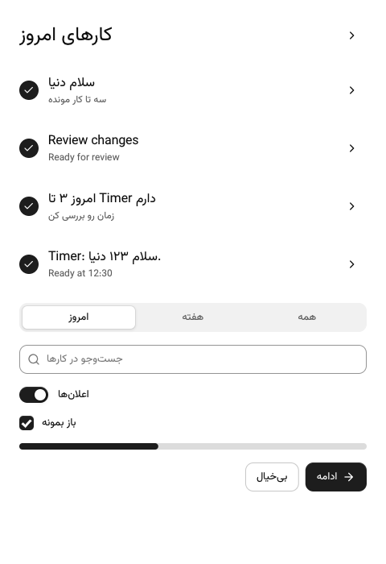
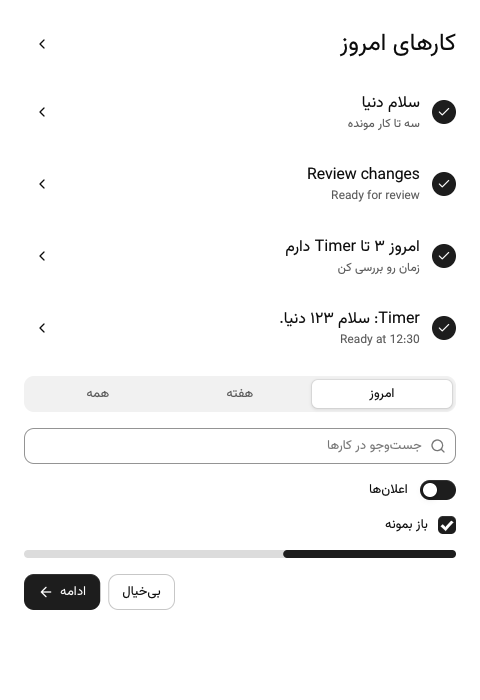
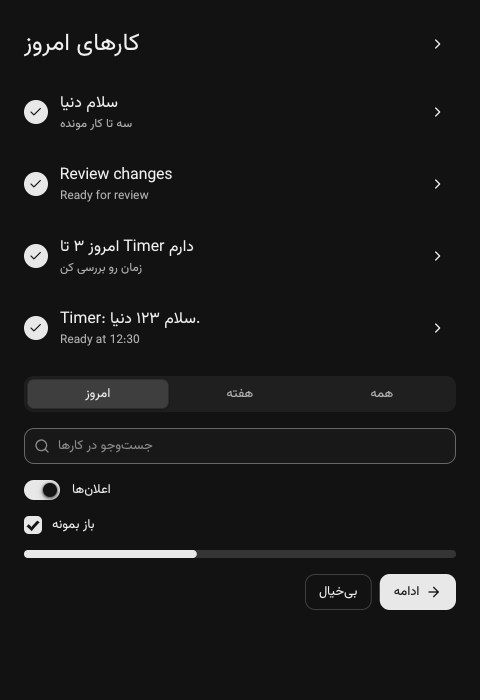
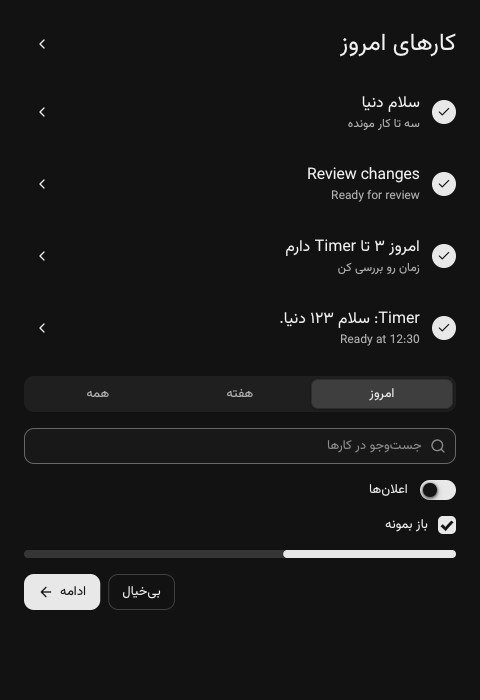

# Layout

CUI lays out a tree of boxes once per frame, after you have described it. The model is a small, predictable subset of flexbox: boxes stack their children in a row or a column, children size themselves from their content, grow into free space or shrink when space runs out.

## Boxes

```c
cui_column(ui, .pad = 24, .gap = 12) { ... }   /* children top to bottom */
cui_row(ui, .gap = 8) { ... }                  /* children left to right */
cui_box(ui, .dir = CUI_STACK) { ... }          /* children on top of each other */
cui_box(ui, .dir = CUI_GRID, .columns = 3, .gap = 16) { ... }
```

Every container accepts the same options (`cui_box` struct):

| Option | Meaning |
|---|---|
| `width`, `height` | A size (see below). Default: fit the content |
| `min_width`, `max_width`, `min_height`, `max_height` | Limits in points |
| `pad`, `pad_x`, `pad_y`, `pad_top`, `pad_right`, `pad_bottom`, `pad_left` | Inner spacing. Specific sides override `pad_x`/`pad_y`, which override `pad` |
| `gap` | Space between children, and between wrapped lines |
| `wrap` | Rows only: children that do not fit move to a new line (see below) |
| `columns`, `min_column_width` | Grids only: the column count, or as many columns as fit (see below) |
| `align` | Cross axis alignment of children: `CUI_ALIGN_START`, `CENTER`, `END`, `STRETCH` |
| `justify` | Main axis distribution: `CUI_JUSTIFY_START`, `CENTER`, `END`, `BETWEEN`, `AROUND` |
| `bg`, `border`, `border_color`, `radius`, `radius_tl`... | Painting |
| `elevation` | `CUI_ELEVATION_RESTING`, `RAISED`, `FLOATING` shadows from the theme |
| `scroll_x`, `scroll_y`, `clip` | Scrolling and clipping |
| `opacity` | 0 to 1 |
| `id` | A stable name, needed for scroll state and for `cui_get_rect` |

## Reading direction

Set `.direction = CUI_DIRECTION_RTL` in `cui_ctx_desc` for a Persian interface.
Containers (`cui_box`, `cui_row`, `cui_column`) and `cui_text` accept the same named
option. Zero (`CUI_DIRECTION_INHERIT`) inherits; the context defaults to LTR.
`CUI_DIRECTION_LTR` overrides an RTL parent. With `CUI_TEXT_SHAPING=ON`,
`CUI_DIRECTION_AUTO` finds the first
strong Unicode character in descendant text, skipping explicitly directed
subtrees and icon glyphs. Digits and punctuation are not strong. With no strong
character it inherits. With shaping OFF, `AUTO` resolves to LTR, including inside
an RTL parent. A row's subtitle inherits the row's result too:

```c
cui_row(ui, .direction = CUI_DIRECTION_AUTO, .width = CUI_FILL) {
    cui_column(ui, .width = CUI_FILL) {
        cui_text(ui, "سلام دنیا");
        cui_secondary(ui, "Ready for review");
    }
    cui_button(ui, "Open");
}
```

RTL mirrors flow children within each container: rows, wrapped rows, columns,
grids, and stacks. Start/end alignment and horizontal padding follow direction;
vertical positioning is unchanged. Absolute offsets remain physical coordinates
(the segmented indicator already follows the selected child's physical bounds).
Pointer hit rectangles use the final positions. Horizontal overflow stays
reachable in RTL: scrolling moves the content toward the right from its start.
Floating layers inherit their opening container's resolved direction.

Text defaults to `CUI_TEXT_START`; `CUI_TEXT_END` follows direction too.
`CUI_TEXT_LEFT` and `CUI_TEXT_RIGHT` are physical.
Explicit `CUI_TEXT_LEFT` keeps the same row centering as default text.
Horizontal chevrons, double chevrons and horizontal arrows in icon nodes swap
glyphs; checks and non-directional symbols do not. Raw `cui_draw_*` calls retain
physical coordinates.

Component coverage:

- Mirrors: layout containers and directional icon nodes as described above,
  switch thumbs, progress fills, and empty input placeholders. Placeholders align
  at the start and use static shaping with their container's direction when enabled.
- Mirrors because they are built from layout boxes: lists, tables, the data grid,
  kanban, tabs, the stepper, the file browser, chat bubbles, the agent plan and
  most cards and forms.
- Keeps left to right on purpose: code (code block, code editor, JSON viewer, diff
  viewer, terminal, hex viewer, log view), numbers and times (rolling counter,
  one-time code, countdown, time dial), key combinations (keycaps, shortcut
  recorder), and the week calendar and gantt, whose grids are drawn by hand under
  a header of layout boxes. A component that keeps LTR still shapes its Persian or
  Arabic text correctly; give it an explicit direction to change it.
- Sliders and range sliders fill from the right, follow the pointer from the right
  and swap the arrow keys; radio cards swap the arrow keys too.
- Does not mirror yet: text areas and Latin-only text in text fields (they stay left
  to right), and other custom-drawn components such as charts, gauges, the mixer
  controls and the node editor. They draw the same in both directions.

Editing, cursor navigation and IME are unchanged, except that with
`CUI_TEXT_SHAPING=ON` a single-line text field edits right-to-left and mixed text by
reading order (see [integration](integration.md#optional-arabic-script-text-shaping)).

With `CUI_TEXT_SHAPING=ON`, the resolved container direction sets the paragraph
base, including English-first mixed text in a forced RTL container. Direct drawing
uses the context direction; AUTO/INHERIT use first-strong, default LTR. Shaped
wrapping preserves paragraph levels; see [integration](integration.md).
Auto classification reuses CUI bidi's Unicode 17.0.0 data when shaping is enabled;
the OFF build includes no Unicode direction table.

**Compatibility:** the new `direction` fields change the sizes of `cui_ctx_desc`,
`cui_box` and `cui_text_opts`. Shared-library users must rebuild the library and
their applications against the updated header. Stored numeric `cui_text_align`
values change meaning: 0 now means `CUI_TEXT_START`, and `CUI_TEXT_LEFT` is now 3.
Use the named constants and update any saved numeric alignments.

`cui_rtl_layout` checks every node rectangle and clicks six distinct RTL buttons.
It also checks physical LEFT row alignment, horizontal overflow in both directions,
popover direction inheritance and placeholder independence from context direction.
With optional `FONT.ttf OUT_PREFIX` arguments it also renders the two probe
screens. `CUI_GALLERY_RTL=1 cui_screenshots OUT_DIR PAGE 1` renders gallery pages
in RTL; it does not imply all custom-painted components support RTL.

The fixture is rendered by `cui_rtl_layout FONT.ttf OUT_PREFIX [dark]`:

| | Before (LTR) | After (RTL) |
|---|---|---|
| Light |  |  |
| Dark |  |  |

## Sizes

| Size | Meaning |
|---|---|
| `CUI_FIT` (default) | As big as the content |
| `CUI_FILL` | Take the remaining space (grow with weight 1) |
| `CUI_GROW(n)` | Take a share `n` of the remaining space |
| `CUI_PX(240)` | Exactly 240 points |
| `CUI_PCT(50)` | 50% of the parent's inner size |

```c
cui_row(ui, .gap = 16) {
    cui_box(ui, .width = CUI_PX(240)) { /* sidebar */ }
    cui_box(ui, .width = CUI_FILL)    { /* content takes the rest */ }
}

cui_row(ui, .gap = 16, .align = CUI_ALIGN_STRETCH) {
    cui_card(ui, .width = CUI_GROW(2)) { /* two thirds */ }
    cui_card(ui, .width = CUI_GROW(1)) { /* one third, same height */ }
}
```

When children want more space than there is, flexible children shrink down to their minimum content size: the longest word for wrapping text, a few characters for single line text (which then shows an ellipsis). Fixed sizes never shrink.

Components with a default width (selects, date and time pickers, number fields, the shortcut recorder) take that width when there is room and shrink to fit a narrower column, like `CUI_FIT` with a preferred size. Give them an explicit `CUI_PX` to pin the width.

## Alignment defaults

- **Columns stretch** their children to the full width. Paragraphs wrap, inputs and cards fill the column.
- **Rows center** their children vertically.
- Components with an intrinsic size (buttons, badges, switches, avatars) never stretch. In a column they sit at the start; in a row they follow the row's alignment.

To center a single thing, give its parent `justify` and `align`:

```c
cui_column(ui, .width = CUI_FILL, .height = CUI_FILL, .align = CUI_ALIGN_CENTER, .justify = CUI_JUSTIFY_CENTER) {
    cui_spinner(ui, 24);
}
```

To limit a content column on wide windows and center it:

```c
cui_row(ui, .justify = CUI_JUSTIFY_CENTER) {
    cui_column(ui, .width = CUI_FILL, .max_width = 920, .pad_x = 40, .gap = 20) { ... }
}
```

## Spacing helpers

```c
cui_spacer(ui);      /* flexible gap: pushes the next children to the end */
cui_gap(ui, 24);     /* fixed gap */
cui_separator(ui);   /* hairline, horizontal in columns and vertical in rows */
```

## Grids

`CUI_GRID` places children in equal columns, row by row. Each row is as tall as its tallest child, and children stretch to fill their cell.

```c
cui_box(ui, .dir = CUI_GRID, .columns = 4, .gap = 16) {
    cui_metric(ui, "Revenue", "$64,210", .delta = 12.4f);
    cui_metric(ui, "Customers", "2,040", .delta = 7.3f);
    cui_metric(ui, "Conversion", "4.1%", .delta = 0.4f);
    cui_metric(ui, "Churn", "1.7%", .delta = -0.6f);
}
```

Add `min_column_width` and the grid picks its own column count: as many columns of at least that width as fit, never fewer than one. With `columns` set as well, that is the most it uses. This is the one line that makes a metric strip or a card gallery work from a phone to a wide monitor:

```c
cui_box(ui, .dir = CUI_GRID, .columns = 4, .min_column_width = 180, .gap = 16) { ... }   /* 4, 3, 2 or 1 columns */
```

## Wrapping rows

`.wrap = true` lets a row continue on a new line when its children do not fit. Each line is laid out like its own row, `justify` applies per line, and `gap` also separates the lines. On one line a wrapping row is exactly a plain row.

```c
cui_row(ui, .gap = 8, .wrap = true) { for (int i = 0; i < n; i++) cui_chip(ui, tags[i], &on[i]); }
```

Children break onto lines at their content width; a growing child breaks at its minimum (`min_width`, or its minimum content width) and then shares the free space on its line. That turns side by side panels into a stack below a width, with no breakpoint code:

```c
cui_row(ui, .width = CUI_FILL, .gap = 16, .wrap = true, .align = CUI_ALIGN_STRETCH) {
    cui_card(ui, .width = CUI_GROW(2), .min_width = 320) { /* chart */ }
    cui_card(ui, .width = CUI_GROW(1), .min_width = 260) { /* breakdown: beside it, or below it on a narrow window */ }
}
```

## Responsive layouts

CUI lays out at whatever size the window is, so a screen adapts when its layout says how. In order of preference:

1. **Fill up to a width** instead of a fixed size: `.width = CUI_FILL, .max_width = 560` fills a phone and stops on a monitor. Cards take `min_width` and `max_width` too.
2. **Wrap and stack**: `wrap` rows for toolbars, chips and side by side panels; `min_column_width` grids for anything in columns.
3. **Change the structure** where a layout does not shrink well: read `cui_viewport_size(ui)` and branch. The demo apps move their sidebar into a `cui_sheet` drawer below 760 points, show one pane at a time on a phone and swap secondary text buttons for icon buttons.

```c
bool narrow = cui_viewport_size(ui).x < 760;
cui_row(ui, .width = CUI_FILL, .height = CUI_FILL, .align = CUI_ALIGN_STRETCH) {
    if (!narrow) { sidebar(ui, s); cui_separator(ui); }
    content(ui, s, narrow);   /* a menu button opens the drawer when narrow */
}
cui_sheet(ui, "Menu", &s->drawer, .side = CUI_SIDE_LEFT, .size = 280) { nav(ui, s); }
```

Components already adapt to the space they get: tabs scroll sideways rather than truncate, tables and the week calendar scroll sideways once their columns would get too narrow, chart legends wrap and a donut's legend moves below it, the calendar heatmap shows the most recent weeks that fit, radio cards drop columns, the date range picker puts its presets above a single month on a phone, and every popover, menu, dialog and sheet stays inside the window. The mouse wheel goes to the innermost scroll area that can move that way, so a sideways strip inside a page does not stop the page from scrolling.

## Stacks

`CUI_STACK` draws children on top of each other. `align` places them horizontally, `justify` vertically. Useful for overlays like a badge on an image.

## Scrolling

```c
cui_scroll(ui, .id = "messages", .gap = 8) {
    for (int i = 0; i < count; i++) message_row(ui, i);
}
```

A scroll area fills the remaining height of its parent by default, scrolls smoothly with the wheel or trackpad, and shows a thin scrollbar while scrolling or when hovered near the edge. The thumb can be dragged. Set `.horizontal = true` to scroll both ways. Jump with `cui_scroll_to(ui, "messages", 0)`.

With `.fade_edges = true` the content fades out at an edge that has more to scroll, instead of being cut off. It works sideways too for `.horizontal` areas. The fade takes the color of the nearest opaque box around the scroll area (the page background if there is none); set `.fade_color` to override it. Source cards and the kanban board fade their overflow the same way.

For long lists, build only what is visible:

```c
int first, last;
cui_virtual_list(ui, "rows", 100000, 36, CUI_FILL, &first, &last) {
    for (int i = first; i < last; i++) row(ui, i);   /* each row exactly 36 points tall */
}
```

## Split views

```c
static float ratio = 0.3f;
cui_split(ui, "main", &ratio, .min_first = 220, .min_second = 360) {
    sidebar(ui);
    cui_split_next(ui);
    editor(ui);
}
```

The divider highlights on hover and can be dragged. Use `.vertical = true` to split top and bottom.

## Reading layout results

Layout is computed at the end of the frame. Interaction uses the rectangles from the previous frame, which is invisible in practice and keeps every component a single function call. To read a rectangle yourself:

```c
cui_id id = cui_box_begin(ui, &(cui_box){ .id = "preview", .width = CUI_FILL, .height = CUI_PX(200) });
cui_box_end(ui);
cui_rect r = cui_get_rect(ui, id);    /* from the latest layout */
```

`cui_last_id(ui)` and `cui_last_rect(ui)` refer to the component created most recently.
